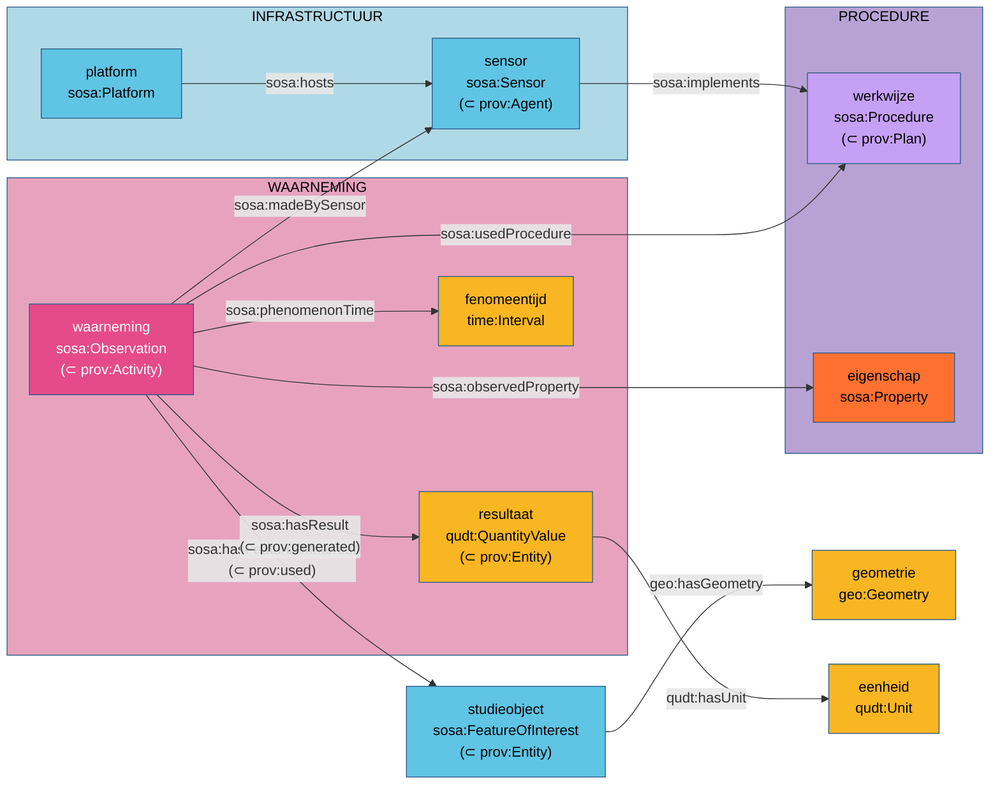

# SSN/SOSA in Vlaanderen

**Een referentiewerk over hoe je data uitdrukt met SOSA, PROV-O, P-PLAN, QUDT, GeoSPARQL en
OWL-Time, als eerste reflex.**

Wie in Vlaanderen meetgegevens, berekeningen, procesdata of kaartlagen als linked data publiceert,
stelt telkens dezelfde vragen. Waarover gaat deze waarde? Wie of wat heeft ze bepaald, volgens
welke werkwijze? In welke eenheid, waar en wanneer? Waar komt ze vandaan? Voor elk van die vragen
bestaat een open, internationale standaard, en die standaarden zijn op elkaar afgestemd. Dit werk
legt uit hoe ze samen één model vormen, welke regels daaruit volgen, en hoe je stap voor stap tot
een goed model komt.

-   **I. Waarom**

    Waarom deze vocabularia de eerste reflex zijn, en hoe ze zich verhouden tot OSLO.

    [:octicons-arrow-right-24: Naar de inleiding](inleiding/index.md)

-   **II. Samenhang**

    Hoe de vocabularia op elkaar aansluiten: de alignments, axioma per axioma, met wat eruit volgt.

    [:octicons-arrow-right-24: Naar de samenhang](samenhang/index.md)

-   **III. Modelleren**

    Vanuit de vragen van de modelleerder: wat bestudeer ik, wat is het resultaat, wanneer en waar?

    [:octicons-arrow-right-24: Modelleren per vraag](modelleren/index.md)

-   **IV. Regels**

    Zeventien regels, elk met het waarom, een goed en een fout voorbeeld.

    [:octicons-arrow-right-24: Naar de regels](regels/index.md)

-   **V. Patronen**

    Oplossingen die in meer dan één domein terugkomen, met wanneer je ze kiest en wanneer niet.

    [:octicons-arrow-right-24: Naar de patronen](patronen/index.md)

-   **VI. Werkwijze**

    Van vraag tot gedragen model in acht stappen, met trajecten voor herzieningen en alternatieven.

    [:octicons-arrow-right-24: Naar de werkwijze](werkwijze/index.md)

-   **VII. Casussen**

    Veertien uitgewerkte voorbeelden uit Vlaamse domeinen, van eenvoudig naar complex.

    [:octicons-arrow-right-24: Naar de casussen](casussen/index.md)

-   **VIII. Oefenen**

    Workshopopdrachten met een referentieoplossing.

    [:octicons-arrow-right-24: Naar de oefeningen](oefenen/index.md)

## In één oogopslag

Eén waarneming verbindt zes vocabularia. SOSA geeft de structuur; PROV-O zegt dat de waarneming
een activiteit is die het studieobject *gebruikt* en het resultaat *genereert*; QUDT drukt het
resultaat uit als getal met eenheid; OWL-Time geeft de periode, GeoSPARQL de plaats. Voor een
proces in meerdere stappen komt P-PLAN erbij. De haakjes tonen de alignments: zonder die
verbanden zijn het zes losse vocabularia, met die verbanden één model. Hoofdstuk
[II. Samenhang](samenhang/index.md) werkt ze uit.

## Voor wie

- **Modelleerders en ontologen** die een domein voor het eerst in linked data uitdrukken, of een
  bestaande mapping willen toetsen.
- **Data-architecten** die moeten beslissen welke vocabularia een organisatie hergebruikt en hoe
  een toepassingsprofiel daarop aansluit.
- **Deelnemers aan een OSLO-traject** die de achtergrond zoeken bij een voorstel.
- **Geïnteresseerden** die willen begrijpen waarom een waarneming een activiteit is en een
  meetwaarde een entiteit.

De [leeswijzer](start/leeswijzer.md) stelt per lezer een route voor.

## Wat dit werk niet is

Het is niet de OSLO-standaard zelf: die wordt in een OSLO-traject vastgelegd en verschijnt in het
[Standaardenregister](https://data.vlaanderen.be/standaarden). Het is evenmin een handleiding van
software. Hulpmiddelen komen aan bod waar ze helpen (in kaders *Hulpmiddel* en in de
[bijlage](bijlagen/hulpmiddelen.md)), maar het werk is geschreven voor mensen die modelleren, met
pen en papier als het moet.
