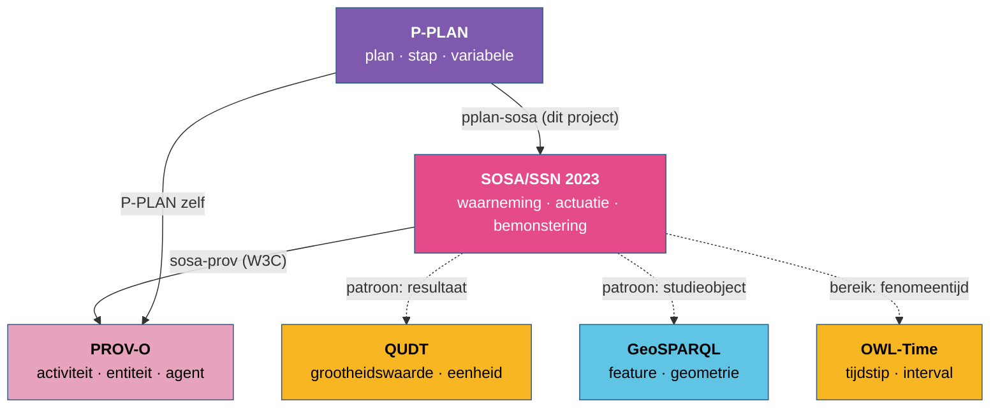

# De kernvocabularia

Zes vocabularia vormen de kern voor waarnemingen en hun context: SOSA/SSN, PROV-O, P-PLAN, QUDT,
GeoSPARQL en OWL-Time. Op P-PLAN na vormen ze, samen met de algemene vocabularia SKOS, DCTERMS
en RDFS ([onderaan](#naast-de-kern)), wat regel [R17](../regels/r17.md) *de kern* noemt: wat je
eerst gebruikt, vóór je verder zoekt. P-PLAN hoort erbij zodra een proces een plan in stappen
heeft ([R4](../regels/r04.md)). Per vocabularium: waarvoor het dient, de begrippen die je het
meest nodig hebt, en wat het uitdrukkelijk *niet* doet. Dat laatste is even belangrijk: veel
fouten ontstaan doordat een vocabularium gebruikt wordt voor iets waarvoor een ander bedoeld is.

Een volle pijl is een formele uitlijning (OWL-axioma's in een gepubliceerde module), een
stippellijn een afspraak over hoe je de vocabularia samen gebruikt. Het onderscheid is belangrijk:
een formele uitlijning laat een redeneerder conclusies trekken en fouten vinden, een afspraak niet.

---

## SOSA/SSN 2023

**Namespace** `http://www.w3.org/ns/sosa/` (SOSA) en `http://www.w3.org/ns/ssn/` (SSN) ·
**uitgever** W3C en OGC (Spatial Data on the Web) · **status** herziening 2023 van de aanbeveling
uit 2017.

SOSA (*Sensor, Observation, Sample, and Actuator*) is de lichte kern, SSN de uitbreiding met
systeemkenmerken. SSN/SOSA 2023 bracht drie veranderingen die voor Vlaamse data belangrijk zijn:

- **één uitvoeringsbegrip**: `sosa:Execution` als gemeenschappelijke superklasse van
  `sosa:Observation`, `sosa:Actuation` en `sosa:Sampling`;
- **collecties**: `sosa:ObservationCollection` en verwanten, waarvan de leden de gedeelde
  eigenschappen erven;
- **termen verhuisd** van `ssn:` naar `sosa:` (`sosa:implements`, `sosa:hasProperty`,
  `sosa:System`) en één `sosa:Property` in plaats van `ObservableProperty` en
  `ActuatableProperty` ([R14](../regels/r14.md)).

| Begrip | Klasse | Kern van de definitie |
|---|---|---|
| waarneming | `sosa:Observation` | het bepalen van de waarde van een eigenschap van een studieobject |
| actuatie | `sosa:Actuation` | het wijzigen van de toestand van een studieobject |
| bemonstering | `sosa:Sampling` | het nemen van een monster dat representatief is voor een studieobject |
| studieobject | `sosa:FeatureOfInterest` | waarover de uitvoering gaat |
| monster | `sosa:Sample`, `sosa:SpatialSample`, `sosa:MaterialSample` | een deel dat representatief is voor een studieobject |
| eigenschap | `sosa:Property` | wat waargenomen of gewijzigd wordt |
| procedure | `sosa:Procedure`, `sosa:ObservingProcedure`, … | de herbruikbare werkwijze |
| sensor, actuator, bemonsteraar | `sosa:Sensor`, `sosa:Actuator`, `sosa:Sampler` (⊂ `sosa:System`) | wie of wat uitvoert |
| platform | `sosa:Platform` | wat systemen draagt of herbergt |
| inzet | `sosa:Deployment` | de opstelling van systemen voor een doel |

**Doet niet:** eenheden (geen eigen eenheidsmodel), geometrie, tijdsmodel, herkomst van records,
planstructuur. Daarvoor zijn de andere vijf.

## PROV-O

**Namespace** `http://www.w3.org/ns/prov#` · **uitgever** W3C · **status** aanbeveling (2013).

PROV-O beschrijft herkomst met drie kernklassen: een **activiteit** (`prov:Activity`) die over een
tijd plaatsvindt, een **entiteit** (`prov:Entity`), een ding met vaste kenmerken, en een
**agent** (`prov:Agent`) die verantwoordelijk is. De relaties daartussen zijn `prov:used`,
`prov:wasGeneratedBy`/`prov:generated`, `prov:wasDerivedFrom`, `prov:wasAssociatedWith` en
`prov:wasAttributedTo`.

Het belangrijkste axioma voor dit werk: **`prov:Activity` en `prov:Entity` zijn disjunct**. Niets
kan tegelijk een activiteit en een entiteit zijn. Omdat SOSA zijn uitvoeringen activiteiten maakt
en zijn studieobjecten, monsters en systemen entiteiten, volgt daaruit een reeks regels
([R16](../regels/r16.md)).

**Doet niet:** wat er waargenomen wordt, met welke eenheid, waar. PROV-O zegt *dat* een activiteit
een entiteit gebruikte, niet dat het om de temperatuur van een lokaal ging.

## P-PLAN

**Namespace** `http://purl.org/net/p-plan#` · **uitgever** onderzoeksgemeenschap (Garijo en Gil)
· **status** stabiel sinds 2014.

P-PLAN breidt PROV-O uit met plannen: een `p-plan:Plan` bestaat uit stappen (`p-plan:Step`) met
input- en outputvariabelen (`p-plan:Variable`). Op uitvoeringsniveau zegt
`p-plan:correspondsToStep` welke stap een activiteit uitvoert, en `p-plan:correspondsToVariable`
welke variabele een entiteit invult. P-PLAN is daarmee de brug tussen het abstracte procesmodel en
wat er werkelijk gebeurde.

In dit werk dient P-PLAN voor het **drielaagse model** (planning, inzet, uitvoering), dat je
gebruikt wanneer een proces meerdere stappen heeft, dezelfde werkwijze op meerdere plaatsen
draait, of traceerbaarheid naar een plan vereist is ([R4](../regels/r04.md)).

**Doet niet:** sensoren, eigenschappen, studieobjecten. Daarvoor is SOSA; de module
[P-PLAN en SOSA](../samenhang/pplan-sosa.md) verbindt beide.

## QUDT

**Namespace** `http://qudt.org/schema/qudt/` (schema) en `http://qudt.org/vocab/unit/` (eenheden) ·
**uitgever** QUDT.org · **versie geladen** 3.5.2.

QUDT (*Quantities, Units, Dimensions and Types*) levert een uitgebreid register van eenheden met
hun dimensie en omrekening, en het schema om een waarde uit te drukken:
`qudt:QuantityValue` met `qudt:numericValue` en `qudt:hasUnit`. Eenheidsnamen zijn niet te
raden: de meter is `unit:M`, milligram per liter `unit:MilliGM-PER-L`.

**Doet niet:** grootheden die aan een stof gebonden zijn ("mg P/L"), of lokale eenheden van een
domein. Daarvoor bestaat in Vlaanderen het eenhedenregister van CSOR, met een mapping naar QUDT
([Register en QUDT](../samenhang/register-qudt.md)).

## GeoSPARQL

**Namespace** `http://www.opengis.net/ont/geosparql#` · **uitgever** OGC · **versie geladen** 1.0.

GeoSPARQL onderscheidt een **feature** (`geo:Feature`, een ding in de wereld met een plaats) van
een **geometrie** (`geo:Geometry`, de wiskundige vorm), verbonden met `geo:hasGeometry`. De vorm
zelf staat in een literal: `geo:asWKT "POINT(4.42 51.21)"^^geo:wktLiteral`. GeoSPARQL definieert
ook ruimtelijke relaties (binnen, overlapt, raakt) en functies om ze in SPARQL te berekenen.

`geo:Feature` en `geo:Geometry` zijn disjunct: een meetpunt is geen punt, het *heeft* een
puntgeometrie.

**Doet niet:** adressen of plaatsnamen. Een plaats die enkel met een adres of beschrijving gekend
is, drukt je uit met `prov:atLocation` of met de OSLO-adresmodellen.

## OWL-Time

**Namespace** `http://www.w3.org/2006/time#` · **uitgever** W3C en OGC · **status** aanbeveling
(2017, bijgewerkt 2022).

OWL-Time onderscheidt een **tijdstip** (`time:Instant`) van een **interval** (`time:Interval`)
met begin en einde. Een tijdstip krijgt zijn waarde met `time:inXSDDateTimeStamp` (altijd met
tijdzone), `time:inXSDDate` of `time:inXSDgYear`; voor tijdschalen die geen kalender zijn
(jaren *Before Present*, geologische tijd) verwijst `time:inTimePosition` naar een
tijdreferentiesysteem (`time:TRS`).

**Doet niet:** het onderscheid tussen *wanneer iets gebeurde* en *wanneer het resultaat er was*.
Dat is SOSA: `sosa:phenomenonTime` (een OWL-Time-entiteit) en `sosa:resultTime` (een literal).

---

## Naast de kern

Vier vocabularia komen bijna overal mee, zonder dat ze een modelleerkeuze vragen:

| Vocabularium | Gebruik |
|---|---|
| **RDFS** | labels (`rdfs:label`), commentaar, subklassen |
| **SKOS** | codelijsten: een eigenschap, een status, een categorie als `skos:Concept` in een `skos:ConceptScheme` |
| **DCTERMS** | identificatie, beschrijving, wijzigingsdatum, bron |
| **XSD** | datatypes van literals |

Andere vocabularia (SAREF, ADMS, OSLO-modellen, CSOR) komen pas na een vergelijking in beeld
([R17](../regels/r17.md)).
