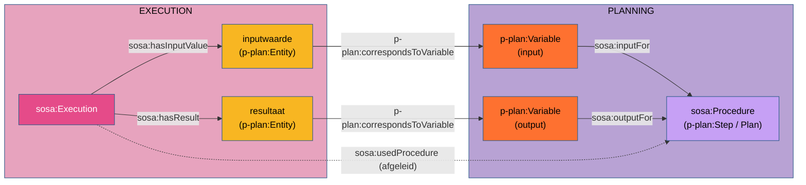

# P-PLAN en SOSA

**Een plan uit stappen, en een uitvoering die bij een stap hoort.** P-PLAN beschrijft plannen met
stappen en variabelen, SOSA beschrijft procedures met inputs en outputs, en uitvoeringen met hun
waarden. Beide spreken over hetzelfde, maar geen van beide publiceert de brug. Dit project doet
dat in een eigen module.

| | |
|---|---|
| **Module** | `pplan-sosa.ttl`, ontologie-IRI het adres van het bestand op GitHub |
| **Uitgever** | dit project (OSLOthema-SSNSOSA-VL), geregistreerd in het [register van alignments](https://github.com/milieuinfo/oslo-ld-kit/blob/main/registers/alignments.ttl) van de kit |
| **Status** | projectmodule; A4 is intussen opgenomen in de W3C-module `sosa-prov` |
| **Bestand** | [`src/main/resources/ontologies/pplan-sosa.ttl`](https://github.com/Informatievlaanderen/OSLOthema-SSNSOSA-VL/blob/main/src/main/resources/ontologies/pplan-sosa.ttl) |
| **Uitgebreide bespreking** | [`pplan-sosa-bespreking.md`](https://github.com/Informatievlaanderen/OSLOthema-SSNSOSA-VL/blob/main/src/main/resources/ontologies/pplan-sosa-bespreking.md) |

P-PLAN zelf is al op PROV-O afgestemd: `p-plan:Plan ⊂ prov:Plan`, `p-plan:Activity ⊂
prov:Activity`, `p-plan:Entity ⊂ prov:Entity`. Omdat SOSA dat via [`sosa-prov`](sosa-prov.md) ook
is, ontmoeten beide elkaar al in PROV-O. De module maakt de rechtstreekse verbanden expliciet.

## 1. Wat de module zegt

| # | Axioma | Betekenis |
|---|---|---|
| A1 | `p-plan:Plan`, `p-plan:Step`, `p-plan:MultiStep` ⊂ `sosa:Procedure` | een plan en een stap zijn herbruikbare werkwijzen; ze kunnen rechtstreeks de waarde van `sosa:usedProcedure`, `sosa:implements` en `sosa:hasInput` zijn |
| A2 | `sosa:inputFor` ← `p-plan:isInputVarOf` ∘ `p-plan:isStepOfPlan` | een inputvariabele van een stap is input voor het plan dat de stap bevat |
| A3 | `sosa:outputFor` ← `p-plan:isOutputVarOf` ∘ `p-plan:isStepOfPlan` | idem voor output |
| A4 | ~~`sosa:hasInputValue` ⊂ `prov:used`~~ | sinds 2026-10-21 in `sosa-prov` ([SOSA en PROV-O](sosa-prov.md#5-inputwaarde-en-resultaat-een-spiegel)) |
| A5 | `sosa:usedProcedure` ← `sosa:hasInputValue` ∘ `p-plan:correspondsToVariable` ∘ `sosa:inputFor` | een uitvoering gebruikt de procedure waarvoor haar inputwaarde een inputvariabele invult |
| A6 | `sosa:usedProcedure` ← `p-plan:correspondsToStep` ∘ `p-plan:isDecomposedAsPlan` | een uitvoering van een stap die als subplan uitgewerkt is, gebruikt dat subplan |
| A7 | `sosa:usedProcedure` ← `sosa:hasResult` ∘ `p-plan:correspondsToVariable` ∘ `sosa:outputFor` | idem via het resultaat |
| A8 | `sosa:usedProcedure` ← `sosa:hasFeatureOfInterest` ∘ `p-plan:correspondsToVariable` ∘ `sosa:inputFor` | idem via het studieobject, wanneer dat een inputvariabele invult |

## 2. Het vierkant dat P-PLAN sluit

SOSA beschrijft inputs op twee niveaus, zonder ze te verbinden: `sosa:hasInput` op de procedure
(het type) en `sosa:hasInputValue` op de uitvoering (de waarde). Dat de waarde bij een bepaalde
input hoort, staat in SOSA enkel in proza ("MUST be consistent with a hasInput definition").
P-PLAN levert de ontbrekende zijde: `p-plan:correspondsToVariable` bindt de concrete entiteit aan
de variabele die ze in het plan invult.



Wie het pad `hasInputValue → correspondsToVariable → inputFor` volgt, komt bij de procedure
waarvoor de waarde een input is. Zonder `correspondsToVariable` blijven de plan- en de
uitvoeringslaag twee losse grafen.

De types sluiten aan: het domein van `correspondsToVariable` is `p-plan:Entity ⊂ prov:Entity`, en
het bereik van `prov:used` en `prov:generated` is `prov:Entity`. De inputwaarde krijgt langs twee
wegen hetzelfde type, nooit een tegenstrijdig.

## 3. Welke procedure: de stap of het definitieplan?

Een stap die zelf als plan uitgewerkt is (`p-plan:isDecomposedAsPlan`), is een
`p-plan:MultiStep`: tegelijk een stap van het omvattende plan en een plan. Bij zo'n stap zijn er
twee kandidaten voor `sosa:usedProcedure`: het *voorkomen* van de stap binnen het omvattende plan,
en de *definitie* ervan, het plan waarin hij ontleed wordt.

SOSA definieert een procedure als een **herbruikbare** werkwijze. Het voorkomen hoort bij één
omvattend plan; de definitie is wat herbruikbaar is. Daaruit volgt één regel, die alle drielaagse
voorbeelden in dit project volgen:

!!! regel "Welke procedure een uitvoering gebruikt"
    - **een gewone stap** (zonder decompositie): de stap zelf;
    - **een `p-plan:MultiStep`**: het plan waarin hij ontleed wordt (`isDecomposedAsPlan`), wat A6
      afleidt.

| Voorbeeld | Soort stap | `sosa:usedProcedure` |
|---|---|---|
| [temperatuur-raam](../casussen/temperatuur-raam.md), [elektrisch-raam](../casussen/elektrisch-raam.md), [PGD](../casussen/pgd.md), EMS PreHeatingHvac | gewone stappen | de stap (`step:temp-meting`, …) |
| [brownies](../casussen/brownies.md), EMS StilleggingProductielijn, EMS Isolatieadvies | MultiSteps | het definitieplan (`plan:baking`, `plan:beslis_stillegging`, …) |

Omdat SHACL enkel de gegeven types ziet, typeert data een stap met decompositie best expliciet
`p-plan:MultiStep`.

## 4. Wat de ketens (nog) niet doen

**De ketens A5–A8 leiden vaak het omvattende plan af, niet de stap.** A2 maakt een inputvariabele
van een stap input voor het *plan* dat de stap bevat, niet voor de stap zelf. A5 en A7 erven die
verschuiving. Een toetsing op de drielaagse voorbeelden (oktober 2026) toont dat A6 telkens de
gegeven procedure oplevert, maar de variabelenketens het omvattende plan, en bij een stap die in
twee plannen voorkomt (PGD: binnen Vlaanderen en polders) twee procedures. Dat is geen
inconsistentie, maar ook niet wat de voorbeelden bedoelen. Een voorstel om dat recht te zetten
ligt voor:

```turtle
# gewone stap: een inputvariabele van een stap is input voor die stap (A1: Step ⊂ Procedure)
p-plan:isInputVarOf  rdfs:subPropertyOf sosa:inputFor .
p-plan:isOutputVarOf rdfs:subPropertyOf sosa:outputFor .
# MultiStep: een inputvariabele is input voor zijn definitieplan
sosa:inputFor  owl:propertyChainAxiom ( p-plan:isInputVarOf  p-plan:isDecomposedAsPlan ) .
sosa:outputFor owl:propertyChainAxiom ( p-plan:isOutputVarOf p-plan:isDecomposedAsPlan ) .
```

Status: *open*. Of A2 en A3 daarnaast blijven (heeft een plan als geheel de inputs van zijn
stappen?), is nog te beslissen.

**De ketens worden in de validatie niet uitgevoerd.** Een redeneerder op RDFS-niveau kent geen
`owl:propertyChainAxiom`. Daarom geven de voorbeelden `sosa:usedProcedure` altijd expliciet. De
ketens documenteren de bedoeling en worden pas actief met een OWL 2 RL- of DL-redeneerder.

**Ketens en kardinaliteit gaan niet samen in OWL 2 DL.** Een eigenschap met een keten is niet
*simple* en mag niet in een kardinaliteitsrestrictie staan. Dat geldt voor `sosa:usedProcedure`
al door de keten in `sosa-prov`. Een profiel dat precies één procedure wil, doet dat met SHACL,
niet met `owl:maxCardinality` (de casus [waterkwaliteit](../casussen/waterkwaliteit.md) heeft die
restrictie om die reden verwijderd).

## 5. Regels die hieruit volgen

| Regel | Bijdrage |
|---|---|
| [R4](../regels/r04.md) Drielaags model | P-PLAN is de planlaag; deze module verbindt ze met SOSA |
| [R5](../regels/r05.md) `hasInput` tegenover `prov:used` | `hasInput` op de stap (het type), `hasInputValue` op de uitvoering (de waarde), `correspondsToVariable` ertussen |
| [R13](../regels/r13.md) Afgeleid en geaggregeerd | in een drielaags model vult `hasInputValue` een inputvariabele in; `prov:used` blijft voor wat geen variabele van de stap is |

## Casussen

- [Brownies](../casussen/brownies.md): het volledige drielaagse patroon, met MultiSteps.
- [Elektrisch raam](../casussen/elektrisch-raam.md): vijf stappen, sensoren die elk een stap
  implementeren, een afgeleide waarneming en een actuatie.
- [Geschiktheidskaart PGD](../casussen/pgd.md): twee QGIS-modellen als plannen die stappen delen.
