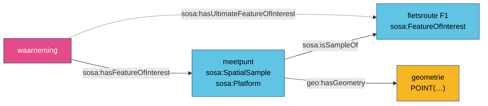

# SOSA en GeoSPARQL

**Een meetpunt is geen punt; het heeft een puntgeometrie.** SOSA zegt waarover een waarneming
gaat, GeoSPARQL zegt waar dat ding ligt. De koppeling is geen module, maar een eigenschap met een
domein: wie een studieobject een geometrie geeft, maakt het een GeoSPARQL-feature.

| | |
|---|---|
| **Soort** | afspraak, met formele gevolgen via het domein van `geo:hasGeometry` |
| **Waar vastgelegd** | regel [R11](../regels/r11.md), patroon [Ruimtelijk monster](../patronen/ruimtelijk-monster.md) |
| **GeoSPARQL-versie in dit project** | 1.0 |

## 1. Het patroon

```turtle
ex:meetpunt-FMN-021 a sosa:Platform , sosa:FeatureOfInterest , sosa:SpatialSample ;
    rdfs:label "Fietstelpost Mercatorstraat"@nl ;
    sosa:isSampleOf ex:fietsroute-F1 ;
    geo:hasGeometry [
        a geo:Geometry ;
        geo:asWKT "POINT(4.423123 51.20910)"^^geo:wktLiteral
    ] .
```

- het studieobject **heeft** een geometrie (`geo:hasGeometry`), het **is** er geen;
- de geometrie draagt de vorm als WKT-literal (`geo:asWKT`), met lengte vóór breedte in WGS84;
- een ander referentiestelsel staat als IRI vooraan in de literal, bv. Lambert 72:
  `"<http://www.opengis.net/def/crs/EPSG/0/31370> POINT(152000 212000)"^^geo:wktLiteral`.

## 2. Wat eruit volgt

`geo:hasGeometry` heeft als domein `geo:Feature`. Een studieobject met een geometrie is dus
afgeleid een `geo:Feature`, en daarmee bevraagbaar met de ruimtelijke functies van GeoSPARQL:
*geef alle waarnemingen waarvan het studieobject binnen deze gemeente ligt*.

Dat geldt voor **elk** studieobject met een gekende plaats, niet alleen voor een monster: een
erosiepoel, een overstort, een rastercel, een lozingspunt. Twee resources op dezelfde plaats mogen
één geometrie delen.

SOSA en GeoSPARQL botsen nergens: `sosa:FeatureOfInterest` is een `prov:Entity`, en `geo:Feature`
is daar niet disjunct mee.

## 3. Het ruimtelijk monster

Vaak staat een meetpunt voor een groter gebied: een telpost voor een fietsroute, een meetplaats
voor een waterloop, een meetpost voor de omgeving van een luchthaven, een rastercel voor een
gewest. SOSA heeft daar een eigen klasse voor: `sosa:SpatialSample`, "een deelverzameling van een
studieobject, gedefinieerd door haar plaats en vorm".



Het studieobject van de waarneming is het **meetpunt**, niet de route: de teller telt fietsers op
één plaats. De route is het *uiteindelijke* studieobject, bereikbaar via `sosa:isSampleOf`
(⊂ `prov:wasDerivedFrom`, dus ook herkomst). Het patroon staat uitgewerkt in
[Ruimtelijk monster](../patronen/ruimtelijk-monster.md).

## 4. Geometrie of locatie?

| | `geo:hasGeometry` | `prov:atLocation` |
|---|---|---|
| bereik | `geo:Geometry`, een vorm met coördinaten | `prov:Location`, elke plaats |
| wanneer | de coördinaten zijn gekend | de plaats is enkel gekend met een adres, een beschrijving, of als een andere resource die zelf een plaats is |
| bevraagbaar met GeoSPARQL-functies | ja | nee, tenzij de locatie zelf een geometrie heeft |

`prov:atLocation` is niet fout, maar het is een tweede keus wanneer coördinaten bestaan. In het
patroon [Emissie als studieobject](../patronen/emissie.md) krijgt een lozing de geometrie van haar
meetput, of een `prov:atLocation` naar de meetput wanneer die enkel een adres heeft.

## 5. Valkuilen

!!! valkuil "WKT rechtstreeks op het studieobject"
    `ex:meetpunt geo:asWKT "POINT(…)"` lijkt korter, maar het domein van `geo:asWKT` is
    `geo:Geometry`, en GeoSPARQL verklaart `geo:Feature` en `geo:Geometry` disjunct. Een meetpunt
    dat ook `geo:hasGeometry` of een feature-type heeft, wordt zo tegelijk feature en geometrie.

!!! valkuil "`geo:` is GeoSPARQL"
    Het prefix `geo:` hoort conventioneel bij GeoSPARQL (`http://www.opengis.net/ont/geosparql#`).
    Het oudere W3C-vocabularium *WGS84 Basic Geo* (`http://www.w3.org/2003/01/geo/wgs84_pos#`, met
    `geo:lat` en `geo:long`) gebruikte hetzelfde prefix. Twee betekenissen voor één prefix
    verwarren lezers en hulpmiddelen; de [overstort](../casussen/overstort.md)-mapping gebruikte
    `geo:lat`/`geo:long` en is herzien naar `geo:hasGeometry` met WKT.

!!! valkuil "Lengte en breedte omgewisseld"
    WKT in WGS84 (CRS84) schrijft **lengte eerst**: `POINT(4.42 51.21)`, niet `POINT(51.21 4.42)`.
    In Lambert 72 is de x de oostwaarde. Bronnen verwisselen de veldnamen geregeld; controleer met
    een kaart.

- **Geen locatie verzinnen.** Als de bron geen plaats geeft, laat je de geometrie weg en zeg je
  dat in de bespreking. Regel R11 noemt de geometrie *sterk aanbevolen*, niet verplicht.

## Casussen

- [Verkeersmetingen](../casussen/verkeersmetingen.md): het telpunt als ruimtelijk monster van een
  fietsroute.
- [Waterkwaliteit](../casussen/waterkwaliteit.md): de meetplaats als ruimtelijk monster van een
  VHA-waterloop.
- [Overstort](../casussen/overstort.md): twee geometrieën, in WGS84 en Lambert 72.
- [Geschiktheidskaart PGD](../casussen/pgd.md): een rastercel als ruimtelijk monster van een gewest.
