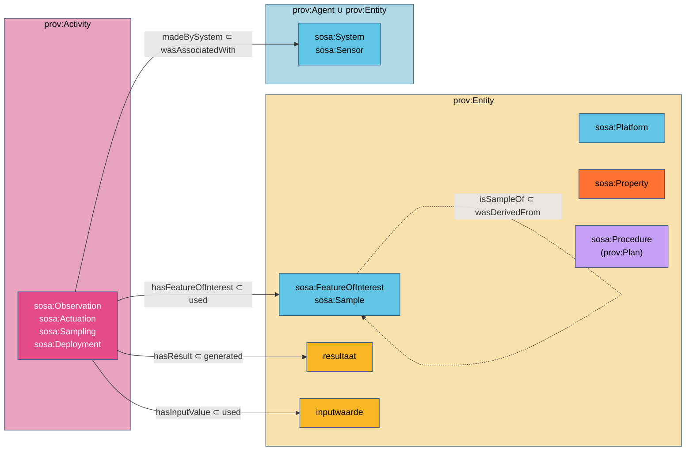

# SOSA en PROV-O

**De belangrijkste alignment van dit werk.** Ze maakt van een waarneming een PROV-activiteit, van
het studieobject, het monster, de eigenschap en het platform PROV-entiteiten, en van het resultaat
iets wat de waarneming genereert. Daaruit volgen vijf van de zeventien regels.

| | |
|---|---|
| **Module** | `sosa-prov` (`http://www.w3.org/ns/sosa/prov/`, versie `http://www.w3.org/ns/sosa/2023/prov`) |
| **Uitgever** | W3C/OGC Spatial Data on the Web, onderdeel van SSN/SOSA 2023 |
| **Status** | niet-normatieve bijlage *PROV Alignment* van de specificatie |
| **Specificatie** | <https://www.w3.org/TR/vocab-ssn-2023/#PROV-alignment> |
| **Bestand** | [`sosa-prov.ttl`](https://github.com/w3c/sdw-sosa-ssn/blob/gh-pages/ssn/rdf/ontology/alignments/sosa-prov.ttl) in `w3c/sdw-sosa-ssn`; kopie in dit project: [`src/main/resources/org/w3/www/ns/sosa/alignments/sosa-prov.ttl`](https://github.com/Informatievlaanderen/OSLOthema-SSNSOSA-VL/blob/main/src/main/resources/org/w3/www/ns/sosa/alignments/sosa-prov.ttl) |

## 1. Wat de module zegt

### Klassen

| SOSA | | PROV-O | Betekenis |
|---|---|---|---|
| `sosa:Execution`, `sosa:Observation`, `sosa:Actuation`, `sosa:Sampling` | ⊂ | `prov:Activity` | een uitvoering is iets wat in de tijd plaatsvindt |
| `sosa:Deployment` | ⊂ | `prov:Activity` | een inzet is ook een activiteit: ze loopt over een periode |
| `sosa:FeatureOfInterest`, `sosa:Sample` | ⊂ | `prov:Entity` | het studieobject en het monster zijn dingen met vaste kenmerken |
| `sosa:Platform` | ⊂ | `prov:Entity` | een platform is een ding |
| `sosa:Property` | ⊂ | `prov:Entity` | ook een eigenschap is een entiteit, geen activiteit |
| `sosa:System`, `sosa:Asset` | ⊂ | `prov:Agent` ∪ `prov:Entity` | een sensor is een ding, en kan verantwoordelijk zijn voor een uitvoering |
| `sosa:Procedure` | ⊂ | `prov:Plan` | een procedure is een plan, en dus een entiteit (`prov:Plan ⊂ prov:Entity`) |

### Eigenschappen

| SOSA | | PROV-O | Betekenis |
|---|---|---|---|
| `sosa:hasFeatureOfInterest` | ⊂ | `prov:used` | een uitvoering gebruikt haar studieobject |
| `sosa:hasInputValue` | ⊂ | `prov:used` | een uitvoering gebruikt haar inputwaarden |
| `sosa:hasResult` | ⊂ | `prov:generated` | een uitvoering genereert haar resultaat |
| `sosa:isResultOf` | ⊂ | `prov:wasGeneratedBy` | het resultaat is gegenereerd door de uitvoering |
| `sosa:isSampleOf` | ⊂ | `prov:wasDerivedFrom` | een monster is afgeleid van wat het vertegenwoordigt |
| `sosa:madeBySystem` (en dus `sosa:madeBySensor`) | ⊂ | `prov:wasAssociatedWith` | het systeem is de agent van de uitvoering |
| `sosa:startTime`, `sosa:endTime` | ⊂ | `prov:startedAtTime`, `prov:endedAtTime` | begin en einde van de uitvoering |
| `sosa:usedProcedure` | ← | `sp:executionAssociation` ∘ `sp:hadProcedure` | de procedure is het plan van de associatie (gekwalificeerde PROV-vorm) |



De figuur is de kaart in het klein: links wat *gebeurt*, rechts wat *is*. Elke SOSA-eigenschap
die een uitvoering met iets verbindt, wordt een PROV-relatie van een activiteit naar een entiteit.

## 2. Wat eruit volgt

### PROV-vragen beantwoorden zonder SOSA te kennen

Neem een waarneming van een fosforconcentratie in een staal:

```turtle
ex:waarneming-1 a sosa:Observation ;
    sosa:hasFeatureOfInterest ex:staal-1 ;
    sosa:madeBySensor ex:labo-toestel ;
    sosa:hasResult ex:resultaat-1 .
```

Met de module leidt een redeneerder af:

```turtle
ex:waarneming-1 a prov:Activity ;
    prov:used ex:staal-1 ;
    prov:wasAssociatedWith ex:labo-toestel ;
    prov:generated ex:resultaat-1 .
ex:staal-1        a prov:Entity .
ex:resultaat-1    a prov:Entity ; prov:wasGeneratedBy ex:waarneming-1 .
ex:labo-toestel   a prov:Agent .
```

Een herkomsttool die enkel PROV-O kent, vindt nu wie het resultaat maakte en wat daarvoor
gebruikt werd. Dat is het eerste voordeel van de kernvocabularia samen: SOSA-data is *ook* herkomstdata.

### Ketens van berekeningen volgen

Een afgeleide waarneming (een dagsom, een vracht, een jaargemiddelde) gebruikt de resultaten van
eerdere waarnemingen met `sosa:hasInputValue`. Met de module wordt dat:

```turtle
ex:uurtelling-08 prov:generated ex:resultaat-08 .   # uit sosa:hasResult
ex:dagsom        prov:used      ex:resultaat-08 .   # uit sosa:hasInputValue
```

Dat is precies de PROV-afleidingsketen *activiteit genereert entiteit, die door een volgende
activiteit gebruikt wordt*. Een query over `prov:generated`/`prov:used` volgt een rekenketen van
begin tot eind, over domeinen heen.

## 3. Welke fouten aantoonbaar worden

PROV-O verklaart `prov:Activity` en `prov:Entity` **disjunct**. Samen met de module wordt elke
resource die langs de ene weg een uitvoering en langs de andere een entiteit wordt, een
tegenspraak. Vijf fouten komen in de praktijk terug; alle vijf zaten in echte mappings die in dit
project herzien zijn.

| Fout | Waarom het een tegenspraak is | Regel | Waar aangetroffen |
|---|---|---|---|
| een **waarneming als inputwaarde**: `ex:afgeleid sosa:hasInputValue ex:bronwaarneming` | `hasInputValue ⊂ prov:used`, bereik `prov:Entity`; de bronwaarneming is een `prov:Activity` | [R7](../regels/r07.md), [R13](../regels/r13.md) | [paleo](../casussen/paleo.md), [verkeersmetingen](../casussen/verkeersmetingen.md) (vóór 2026-10-01) |
| een **waarneming als resultaat**: `ex:w1 sosa:hasResult ex:w2` | `hasResult ⊂ prov:generated`, bereik `prov:Entity` | [R16](../regels/r16.md) | — (fout 3 van R16) |
| **recordgegevens op de waarneming**: `prov:generatedAtTime`, `prov:wasGeneratedBy` op een `sosa:Observation` | het domein van die eigenschappen is `prov:Entity` | [R16](../regels/r16.md) | [overstort](../casussen/overstort.md) (Aquafin-LDES) |
| **uitvoeringseigenschappen op een sensor**: `ex:sensor sosa:hasFeatureOfInterest ex:meetpunt` | `hasFeatureOfInterest ⊂ prov:used`, domein `prov:Activity`; een sensor is een entiteit | [R16](../regels/r16.md) | [overstort](../casussen/overstort.md) |
| **een collectie als inputwaarde**: `ex:dagsom sosa:hasInputValue ex:collectie` | een collectie met `sosa:hasFeatureOfInterest` wordt via het domein van `prov:used` een activiteit, en via `hasInputValue` een entiteit | [R13](../regels/r13.md) | [verkeersmetingen](../casussen/verkeersmetingen.md) (vóór 2026-10-01) |

!!! valkuil "Een stille fout wordt een luide fout"
    Zonder de alignment is `ex:dagsom sosa:hasInputValue ex:uurtelling-08` vrij van tegenspraak:
    SOSA geeft `hasInputValue` geen bereik. Het model zegt dan iets wat niemand bedoelt (de
    dagsom gebruikt de *telling*, niet het *aantal*), zonder dat iets het opmerkt. Met de
    alignment is het een inconsistentie die elke redeneerder vindt.

### Wat niet botst, maar toch fout is

Niet elke verkeerde eigenschap geeft een tegenspraak. `sosa:observedProperty` op een sensor (in
plaats van `sosa:observes`) of `sosa:actsOnProperty` op een actuator (in plaats van
`sosa:actsOn`) zijn tegen de definitie, maar die eigenschappen hebben geen PROV-domein. En
`dct:modified` of `dct:isVersionOf` op een waarneming botsen met niets, omdat DCTERMS bewust geen
domein geeft. Daar helpt enkel de definitie lezen ([R16](../regels/r16.md)).

## 4. Drie keuzes die de module maakt

**Een systeem is agent of entiteit.** `sosa:System ⊂ prov:Agent ∪ prov:Entity`: een sensor kan
verantwoordelijk zijn voor een waarneming (agent) en is ook een ding met een serienummer en een
fabrikant (entiteit). PROV-O verklaart agent en entiteit niet disjunct, dus beide lezingen kunnen
samen. Omdat `sosa:madeBySystem ⊂ prov:wasAssociatedWith` (bereik `prov:Agent`), wordt elke sensor
die een waarneming maakt, afgeleid een agent. De samengevoegde SOSA-versie die in dit project
geladen is, maakt `sosa:System` meteen subklasse van beide.

**Een eigenschap is een entiteit.** `sosa:Property ⊂ prov:Entity`. Dat lijkt vreemd (is
*temperatuur* een ding?), maar het betekent vooral dat een eigenschap *geen activiteit* is. Wie per
vergissing een waarneming als `sosa:observedProperty` opgeeft, krijgt een tegenspraak.

**Een procedure is een plan.** `sosa:Procedure ⊂ prov:Plan`. In PROV-O is een plan de entiteit die
een agent volgt bij een activiteit. Daarmee sluit SOSA aan op P-PLAN, waar een plan uit stappen
en variabelen bestaat ([P-PLAN en SOSA](pplan-sosa.md)).

## 5. Inputwaarde en resultaat: een spiegel

De module vergt dat je input en output op dezelfde manier leest. SOSA beschrijft ze telkens als
paar, op twee niveaus:

| | input | output |
|---|---|---|
| procedure (het type) | `sosa:hasInput` | `sosa:hasOutput` |
| uitvoering (de waarde) | `sosa:hasInputValue` | `sosa:hasResult` |
| PROV-O | `prov:used` | `prov:generated` |
| uitlijning | `hasInputValue ⊂ prov:used` | `hasResult ⊂ prov:generated` |

SOSA zegt het zelf: het resultaat "MUST be consistent with the hasOutput definition", de
inputwaarde "MUST be consistent with a hasInput definition" van de procedure. `hasResult` staat tot
`hasOutput` zoals `hasInputValue` tot `hasInput`: de concrete waarde tegenover het type. Daaruit
volgt regel [R5](../regels/r05.md): `sosa:hasInput` hoort op de procedure, nooit met een concrete
waarde op een waarneming.

!!! note "Een bijdrage uit Vlaanderen"
    Tot oktober 2026 stond `sosa:hasInputValue ⊂ prov:used` niet in de module: de rechterkolom
    was uitgelijnd, de linker niet. Dit project stelde het axioma voor aan de W3C-werkgroep, met
    de tabel hierboven als kern en de fouten uit paleo en verkeersmetingen als bewijs
    ([w3c/sdw-sosa-ssn#556](https://github.com/w3c/sdw-sosa-ssn/issues/556)). De werkgroep
    aanvaardde het en nam het op 2026-10-21 op in `sosa-prov` (PR #563). Het was eerst een axioma
    in een projectmodule, nu is het een uitlijning van SOSA zelf.

## 6. Regels die hieruit volgen

| Regel | Wat de alignment bijdraagt |
|---|---|
| [R3](../regels/r03.md) Resultaat met eenheid | het resultaat is een `prov:Entity`; een literal kan het niet zijn, daarvoor is `sosa:hasSimpleResult` |
| [R5](../regels/r05.md) `hasInput` tegenover `prov:used` | de waarde op uitvoeringsniveau is `hasInputValue` (⊂ `prov:used`), het type op procedureniveau `hasInput` |
| [R7](../regels/r07.md), [R13](../regels/r13.md) Afgeleide waarnemingen | inputwaarden zijn resultaten (entiteiten), de bronwaarnemingen worden met `sosa:relatedObservation` verbonden |
| [R16](../regels/r16.md) Activiteit of entiteit | de algemene regel: geen eigenschap van de ene kant op een resource van de andere kant |
| [R6](../regels/r06.md) ML-model als artefact | een getraind model is een `prov:Entity`, gegenereerd door een trainingsactiviteit |

## Casussen

- [Paleoklimaat](../casussen/paleo.md): de fout *waarneming als inputwaarde*, en de correctie.
- [Verkeersmetingen](../casussen/verkeersmetingen.md): een dagsom als afgeleide waarneming.
- [Overstort](../casussen/overstort.md): record of waarneming, en uitvoeringseigenschappen op een
  sensor.
- [Geluidsmeetnet](../casussen/geluidsmeetnet.md): ketens van afgeleiden (Lden uit Ld, Le, Ln).
