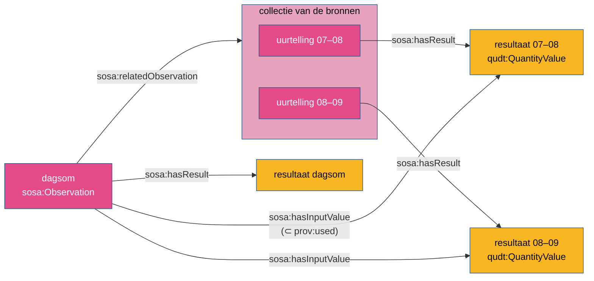

# Hoe is het berekend?

Veel gepubliceerde waarden zijn niet gemeten maar berekend: een dagsom uit uurtellingen, een
jaargemiddelde, een vracht uit concentratie en debiet, een Lden uit Ld, Le en Ln, een
geschiktheidsklasse uit drie scores. SOSA noemt dat geen apart begrip: een berekening is ook een
waarneming, uitgevoerd door een "sensor" die software kan zijn, volgens een procedure. Wat ze
bijzonder maakt, is dat ze andere waarden gebruikt.

## Het patroon



```turtle
ex:dagsom a sosa:Observation ;
    sosa:hasFeatureOfInterest ex:meetpunt ;
    sosa:observedProperty ex:verkeersintensiteit ;
    sosa:madeBySensor ex:aggregatiemodule ;
    sosa:usedProcedure ex:dagsomprocedure ;
    sosa:hasInputValue ex:resultaat-00 , ex:resultaat-01 , ex:resultaat-23 ;   # …
    sosa:relatedObservation ex:dagcollectie ;
    sosa:phenomenonTime ex:interval-dag ;
    sosa:hasResult ex:resultaat-dagsom .
```

Vier afspraken ([R7](../regels/r07.md), [R13](../regels/r13.md)):

1. **`sosa:hasInputValue` naar de resultaten**, de waarden waarmee gerekend werd. Niet naar de
   bronwaarnemingen en niet naar de collectie: dat zijn activiteiten, geen waarden.
2. **`sosa:relatedObservation` naar de bronwaarnemingen** of hun collectie: de band met waar de
   waarden vandaan komen.
3. **Niet in de collectie van de bronnen.** De dagsom is geen 25ste uurtelling; ze heeft een
   andere procedure en sensor, en misschien een andere eigenschap.
4. **Alle verplichte eigenschappen expliciet.** Een afgeleide waarneming erft niets van een
   collectie waarvan ze geen lid is: studieobject, eigenschap, sensor en procedure staan erop.

## Waarom de resultaten, niet de waarnemingen

Omdat het de waarden zijn die gebruikt worden. SOSA definieert `sosa:hasInputValue` als "kent een
*waarde* toe aan een input, gedefinieerd door de procedure". De uitlijning met PROV-O maakt het
formeel: `sosa:hasInputValue ⊂ prov:used`, met als bereik `prov:Entity`. Een waarneming is een
`prov:Activity`, en die twee zijn disjunct. Een waarneming als inputwaarde maakt het model dus
**inconsistent** ([SOSA en PROV-O](../samenhang/sosa-prov.md#3-welke-fouten-aantoonbaar-worden)).

!!! valkuil "Twee voorbeelden die het fout deden"
    In [paleo](../casussen/paleo.md) en [verkeersmetingen](../casussen/verkeersmetingen.md)
    verwees de afgeleide waarneming met `sosa:hasInputValue` naar de bronwaarnemingen,
    respectievelijk naar de collectie. Beide zijn op 2026-10-01 rechtgezet. De fout was de
    aanleiding voor het axioma `hasInputValue ⊂ prov:used` in de W3C-module.

Een gevolg: wie afgeleide waarnemingen heeft, geeft de bronresultaten een **eigen resource**
(`sosa:hasResult` met een `qudt:QuantityValue`), geen literal: een literal kan geen inputwaarde
zijn.

## Ketens

Een afgeleide kan zelf input zijn. In het [geluidsmeetnet](../casussen/geluidsmeetnet.md) worden
Ld, Le en Ln berekend uit de geluidsevents van een dag, en Lden uit Ld, Le en Ln: een afgeleide
van afgeleiden. Het patroon blijft hetzelfde: elke stap verwijst naar de resultaten van de vorige.

Met PROV-O wordt zo'n keten opvraagbaar zonder SOSA-kennis:

```sparql
# alle waarnemingen waarvan Lden, rechtstreeks of onrechtstreeks, de resultaten gebruikte
SELECT ?bron WHERE {
  ex:lden (prov:used/prov:wasGeneratedBy)+ ?bron .
}
```

(`prov:wasGeneratedBy` volgt uit `sosa:isResultOf`, of uit de inverse van `sosa:hasResult` bij een
redeneerder die inversen kent.)

## In een drielaags model

In een proces met een plan ([Volgens welk plan?](plan.md)) vult een inputwaarde een variabele van
de stap in. Dan krijgt de concrete waarde ook `p-plan:correspondsToVariable`:

```turtle
exec:afwijking a sosa:Observation ;
    p-plan:correspondsToStep step:afwijking-berekenen ;
    sosa:hasInputValue ent:temperatuur-0930 .
ent:temperatuur-0930 p-plan:correspondsToVariable var:gemeten-temperatuur .
```

`prov:used` blijft voor wat geen inputvariabele van de stap is, zoals een gebruikt
machinaal-leermodel ([R6](../regels/r06.md)).

## Wanneer is iets een afgeleide waarneming?

| Situatie | Model |
|---|---|
| een waarde berekend uit andere gepubliceerde waarden | afgeleide waarneming, zoals hierboven |
| een berekening binnen het toestel (een sensor die intern middelt) | een gewone waarneming; de berekening zit in de procedure |
| een berekening waarvan de bronwaarden niet gepubliceerd worden | een gewone waarneming, met de berekening in de procedure; eventueel `sosa:relatedObservation` |
| een beslissing die iets in de wereld verandert (raam openen) | een **actuatie** die de resultaten van waarnemingen als inputwaarde heeft |
