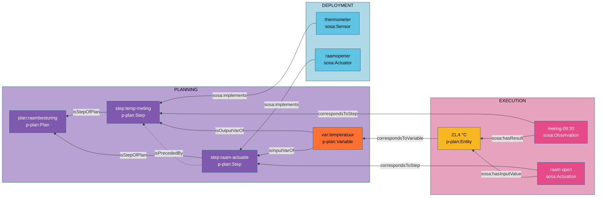

# Volgens welk plan?

## Procedure

Elke uitvoering volgt een werkwijze: een meetnorm, een labomethode, een telprotocol, een
algoritme, een recept. SOSA noemt dat een **procedure** (`sosa:Procedure`, met
`sosa:ObservingProcedure`, `sosa:ActuatingProcedure` en `sosa:SamplingProcedure`): "herbruikbaar,
en toepasbaar in meerdere uitvoeringen". De sensor implementeert ze (`sosa:implements`), de
waarneming gebruikt ze (`sosa:usedProcedure`).

```turtle
ex:telprocedure a sosa:ObservingProcedure ;
    rdfs:label "Automatische telling met inductielussen, per uur"@nl ;
    sosa:hasInput ex:lusdetectie ;
    sosa:hasOutput ex:uurtotaal .
ex:teller sosa:implements ex:telprocedure .
ex:uurtelling-08 sosa:usedProcedure ex:telprocedure .
```

Op de procedure beschrijven `sosa:hasInput` en `sosa:hasOutput` de **types** van wat ze gebruikt
en oplevert. De concrete waarden staan op de uitvoering: `sosa:hasInputValue` en `sosa:hasResult`
([R5](../regels/r05.md)).

!!! valkuil "`sosa:hasInput` op een waarneming"
    `ex:waarneming sosa:hasInput ex:temperatuur-0930` zet een concrete waarde op de plaats van een
    type. Op de uitvoering is het `sosa:hasInputValue`.

## Plat of drielaags

Voor de meeste datasets volstaat het **platte model**: infrastructuur, procedure en waarneming,
eventueel met een collectie. Het **drielaagse model** komt in beeld wanneer ([R4](../regels/r04.md)):

- (a) het proces **meerdere stappen** heeft, met een gegevensstroom ertussen;
- (b) dezelfde werkwijze op **meerdere platformen of gegevens** draait;
- (c) **traceerbaarheid naar een abstract plan** vereist is.

| Laag | Wat | Vocabularium |
|---|---|---|
| **Planning** | het plan, de stappen, de variabelen en hun volgorde | P-PLAN (`p-plan:Plan`, `p-plan:Step`, `p-plan:Variable`) |
| **Deployment** | welke systemen welke stap uitvoeren, waar | SOSA (`sosa:Deployment`, `sosa:implements`) |
| **Execution** | de concrete uitvoeringen en hun waarden | SOSA en PROV-O, met `p-plan:correspondsToStep` en `p-plan:correspondsToVariable` |



Een stap is zelf een procedure (`p-plan:Step ⊂ sosa:Procedure`, [P-PLAN en SOSA](../samenhang/pplan-sosa.md)):
de sensor implementeert de stap, de waarneming gebruikt de stap. De waarde die de waarneming
oplevert, vult een variabele in, die input is voor de volgende stap.

## Welke procedure geeft een uitvoering?

- bij een **gewone stap**: de stap zelf;
- bij een stap die als subplan uitgewerkt is (`p-plan:MultiStep`, met `p-plan:isDecomposedAsPlan`):
  het subplan, de herbruikbare definitie.

## Wanneer niet drielaags

Een export die de *resultaten* van een meerstappenketen bevat, maar niets over de stappen zelf
(drempels, regels, correlatievensters), rechtvaardigt geen plan: dat plan zou verzonnen zijn. Het
[geluidsmeetnet](../casussen/geluidsmeetnet.md) onderzocht een drielaags model en koos het platte,
met afgeleide waarnemingen voor wat wel expliciet is: de berekening van de dagindicatoren.

## Prefixen per laag

Drielaagse voorbeelden geven elke laag een eigen prefix, zodat een IRI meteen zegt waar ze hoort:
`plan:`, `step:`, `var:` voor de planning; `exec:`, `ent:` voor de uitvoering; `inst:` en
`prop:` voor infrastructuur en eigenschappen.
