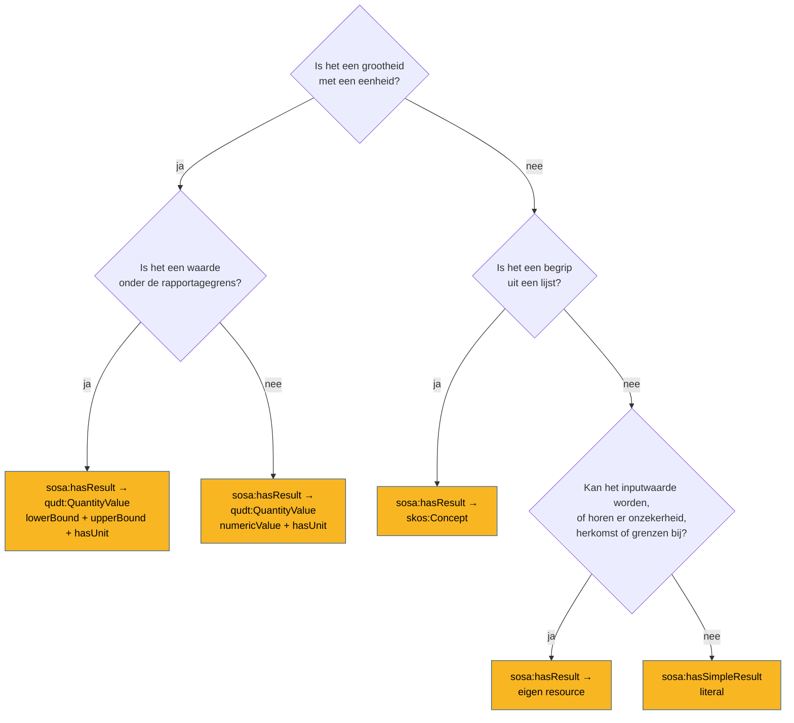

# Wat is het resultaat?

Het resultaat is wat de waarneming opleverde: een getal met een eenheid, een code, een tekst, een
monster. Het hoofdstuk [SOSA en QUDT](../kaart/sosa-qudt.md) legt uit waarom het patroon is wat
het is; deze pagina helpt kiezen.

## Kiezen



## Een grootheid

```turtle
ex:waarneming sosa:hasResult ex:resultaat-1 .
ex:resultaat-1 a qudt:QuantityValue ;
    qudt:numericValue 214 ;
    qudt:hasUnit unit:NUM .
```

Het getal in `qudt:numericValue`, de eenheid in `qudt:hasUnit`, uit QUDT of uit een register
([R3](../regels/r03.md), [Register en QUDT](../kaart/register-qudt.md)). Een blanco knoop
volstaat in een klein voorbeeld; een IRI wanneer het resultaat inputwaarde wordt of van buitenaf
aanspreekbaar moet zijn.

## Onder de rapportagegrens

Een labo rapporteert "< 0,0125 µg/L": de stof is niet aangetoond boven die grens. Dat is geen
meting van 0,0125, en ook geen nul. Het resultaat krijgt **geen** `qudt:numericValue`, maar het
interval:

```turtle
ex:resultaat-2 a qudt:QuantityValue ;
    qudt:lowerBound 0.0 ;
    qudt:upperBound 0.0125 ;
    qudt:hasUnit unit:MicroGM-PER-L .
```

Het teken volgt uit wat er staat: `numericValue` voor een gemeten waarde, enkel grenzen voor
"kleiner dan". Een aparte codelijst voor het teken is niet nodig. Het patroon staat in
[Rapportagegrens](../patronen/rapportagegrens.md). Het is geen randgeval: in de
oppervlaktewaterdata van de casus [waterkwaliteit](../casussen/waterkwaliteit.md) liggen 834 van
de 999 resultaten onder de grens.

## Een begrip uit een lijst

Een kwalitatieve uitkomst (een geschiktheidsklasse, een status "overstort in werking", een
score "goed") is een `skos:Concept` uit een codelijst:

```turtle
ex:waarneming-score sosa:hasResult score:kansrijk .
score:kansrijk a skos:Concept ;
    skos:prefLabel "kansrijk"@nl ;
    skos:inScheme score:kansrijkheid .
```

## Een literal

`sosa:hasSimpleResult` geeft het resultaat als literal, zonder eenheid of verdere beschrijving.
Het volstaat voor een tekst, een booleaanse waarde, een identificatie. Het kan **geen
inputwaarde** zijn van een afgeleide waarneming (een literal is geen entiteit), en een eenheid kan
er niet bij. In twijfel: een resource.

## Wat het resultaat niet is

!!! valkuil "Een andere waarneming"
    `sosa:hasResult` is een subproperty van `prov:generated`, met als bereik `prov:Entity`. Een
    waarneming als resultaat wordt zo een entiteit, terwijl ze een activiteit is
    ([R16](../regels/r16.md)). Wat je wil zeggen, is meestal dat een waarneming *afgeleid* is van
    een andere ([Hoe is het berekend?](afgeleid.md)).

- **Niet `sosa:Result`**: verouderd in SSN/SOSA 2023.
- **Niet `qudt:value`**: bestaat, maar het is `qudt:numericValue`.
- **Niet `qudt:unit`**: bestaat niet; het is `qudt:hasUnit`.
- **Bij een bemonstering** is het resultaat een monster (`sosa:Sample`), geen grootheid.
- **Bij een actuatie** is het resultaat de toestand na de actuatie (bv. raamstand 100 %), of, bij
  een passieve bron, de emissie die ze veroorzaakte ([Emissie als studieobject](../patronen/emissie.md)).

## Eén stijl per voorbeeld

Gebruik binnen één dataset één vorm voor vergelijkbare resultaten: alle numerieke resultaten als
`qudt:QuantityValue`, niet de ene keer een literal en de andere keer een resource. Een query moet
niet twee vormen naast elkaar verwachten.
