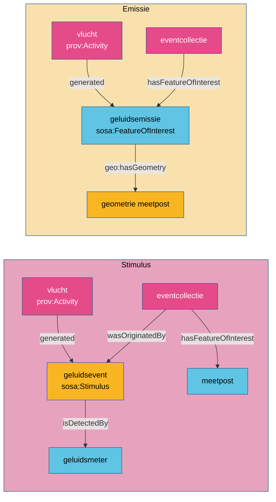

# V. Patronen

Een patroon is een oplossing die in meer dan één domein terugkomt. Kijk vóór je een nieuw domein
modelleert, of een patroon past. Kies dan bewust: volg het patroon (samenhang over domeinen heen),
of modelleer de eigen lezing van het domein en leg uit waarom. Zijn beide verdedigbaar, werk dan
een [alternatief](../werkwijze/alternatief.md) uit in plaats van stil te kiezen.

| Patroon | Kern | Gebruikt in |
|---|---|---|
| [Emissie als studieobject](emissie.md) | de uitstoot is het studieobject, gegenereerd door een activiteit | [waterkwaliteit](../casussen/waterkwaliteit.md) (lozing), [geluidsmeetnet](../casussen/geluidsmeetnet.md) (alternatief), [overstort](../casussen/overstort.md) (alternatief) |
| [Stimulus](stimulus.md) | de gebeurtenis die een sensor doet meten; het studieobject blijft de plaats | [geluidsmeetnet](../casussen/geluidsmeetnet.md) (hoofdmodel) |
| [Monster en uiteindelijk studieobject](monster.md) | het monster is het studieobject, het bemonsterde ding het uiteindelijke | [waterkwaliteit](../casussen/waterkwaliteit.md), [paleo](../casussen/paleo.md) |
| [Ruimtelijk monster](ruimtelijk-monster.md) | een meetpunt als monster van een groter gebied | [verkeersmetingen](../casussen/verkeersmetingen.md), [waterkwaliteit](../casussen/waterkwaliteit.md), [geluidsmeetnet](../casussen/geluidsmeetnet.md), [PGD](../casussen/pgd.md) |
| [Afgeleide waarneming](afgeleide-waarneming.md) | berekend uit de resultaten van andere waarnemingen | [verkeersmetingen](../casussen/verkeersmetingen.md), [geluidsmeetnet](../casussen/geluidsmeetnet.md), [paleo](../casussen/paleo.md), [waterkwaliteit](../casussen/waterkwaliteit.md) |
| [Rapportagegrens](rapportagegrens.md) | "< X" als interval, niet als waarde | [waterkwaliteit](../casussen/waterkwaliteit.md) |

## Twee lezingen van een gebeurtenis

Twee patronen beantwoorden dezelfde vraag op een andere manier: wat is het studieobject bij een
gebeurtenis die een meting veroorzaakt?

| | Stimulus | Emissie |
|---|---|---|
| de vraag | wat krijgt deze plaats te verduren? | wat stoot deze bron uit? |
| studieobject | de meetpost | de emissie |
| bron | via de stimulus en `prov:wasGeneratedBy` | via `prov:wasGeneratedBy` op het studieobject |
| volgt | de sensorketen van SOSA zelf | het patroon van de lozingen in waterkwaliteit |

In dit project staan beide lezingen van de geluidsdata naast elkaar. De keuze ligt bij de
werkgroep.

## Een nieuw patroon

Een patroon komt in de [gids](https://github.com/milieuinfo/oslo-ld-kit/blob/main/guide/patterns.md)
wanneer een werkgroep een keuze maakt die een algemene afspraak wordt. Dit werk volgt vanzelf: het
bouwen van de site faalt zolang een nieuw patroon van de gids hier geen pagina heeft.
