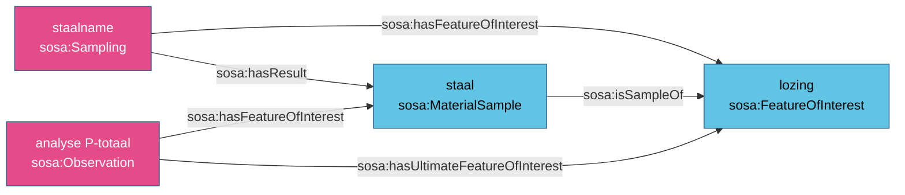

# Monster en uiteindelijk studieobject

**Het geanalyseerde monster is het studieobject van de analyse; het bemonsterde ding is het
uiteindelijke studieobject.** Het monster ontstaat in een bemonstering, met het monster als
resultaat.

## Het patroon



```turtle
ex:staalname-1 a sosa:Sampling ;
    sosa:hasFeatureOfInterest ex:lozing-2400006 ;
    sosa:madeBySampler ex:meetput-2400006 ;
    sosa:hasResult ex:staal-1 .

ex:staal-1 a sosa:MaterialSample , sosa:FeatureOfInterest ;
    sosa:isSampleOf ex:lozing-2400006 .

ex:analyse-ptot a sosa:Observation ;
    sosa:hasFeatureOfInterest ex:staal-1 ;
    sosa:hasUltimateFeatureOfInterest ex:lozing-2400006 .
```

## Waarom het samenhangt met de kernvocabularia

- `sosa:isSampleOf ⊂ prov:wasDerivedFrom`: het monster is afgeleid van wat het vertegenwoordigt;
  de monsterketen is herkomst.
- Het resultaat van een bemonstering is een monster; via `sosa:hasResult ⊂ prov:generated` is het
  een entiteit, gegenereerd door de staalname.
- Het uiteindelijke studieobject maakt de meest gestelde vraag (*alles over deze lozing*) kort,
  ook als er veel stalen zijn.

Ketens mogen langer zijn: luchtbel → ijskern → aardkorst ([R8](../regels/r08.md)).

## Gebruikt in

- [Waterkwaliteit](../casussen/waterkwaliteit.md): staal → lozing, met staalname en meetput.
- [Paleoklimaat](../casussen/paleo.md): luchtbel → ijskern → aardkorst, met twee bemonsteringen.

??? quote "Normatieve tekst (modelleergids, Engels)"

    --8<-- "kit/patroon-monster.md"
