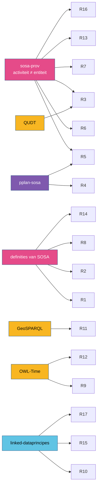

# IV. Regels

Zeventien regels, met vaste nummers. Ze staan normatief, in het Engels, in de
[modelleergids](https://github.com/milieuinfo/oslo-ld-kit/tree/main/guide) van de kit; elke pagina
hier geeft de regel kort, **het waarom**, een goed en een fout voorbeeld, de casussen waarin ze
speelt, en de normatieve tekst in een uitklapbaar kader. Een nieuwe regel krijgt het volgende
vrije nummer; een ingetrokken regel houdt zijn nummer.

## Overzicht

| # | Regel | Waarom, in één zin | Volgt uit |
|---|---|---|---|
| [R1](r01.md) | Kies de infrastructuurklasse naar de rol | platform, systeem, sensor, actuator, studieobject en monster zijn verschillende rollen, en één ding kan er meerdere hebben | SOSA-definities |
| [R2](r02.md) | Een waarneming heeft studieobject, eigenschap en resultaat | zonder die drie zegt een waarneming niets; sensor en procedure maken ze beoordeelbaar | SOSA-definities |
| [R3](r03.md) | Een resultaat met eenheid is een `qudt:QuantityValue` | de eenheid hoort bij de waarde, en een resource kan inputwaarde zijn | [SOSA en QUDT](../samenhang/sosa-qudt.md), [SOSA en PROV-O](../samenhang/sosa-prov.md) |
| [R4](r04.md) | Drielaags enkel bij meerdere stappen, hergebruik of traceerbaarheid | een plan dat niemand nodig heeft, is ballast | [P-PLAN en SOSA](../samenhang/pplan-sosa.md) |
| [R5](r05.md) | `sosa:hasInput` op de procedure, waarden op de uitvoering | type en waarde zijn verschillende niveaus | [SOSA en PROV-O](../samenhang/sosa-prov.md) §5 |
| [R6](r06.md) | Een ML-model is een artefact, geen sensor | het model wordt gebruikt; de software die het toepast, waarneemt | PROV-O |
| [R7](r07.md) | Afgeleide waarnemingen gebruiken resultaten | een inputwaarde is een entiteit, een waarneming een activiteit | [SOSA en PROV-O](../samenhang/sosa-prov.md) |
| [R8](r08.md) | Monsterketens lopen naar boven | elk monster is een monster *van* iets | SOSA, PROV-O (`isSampleOf ⊂ wasDerivedFrom`) |
| [R9](r09.md) | Niet-kalendertijd via een benoemd tijdreferentiesysteem | jaren BP zijn geen kalenderjaren | [SOSA en OWL-Time](../samenhang/sosa-time.md) |
| [R10](r10.md) | IRI's: gezaghebbend, stabiel, niet in andermans namespace | anderen moeten kunnen verwijzen, ook morgen | linked-dataprincipes |
| [R11](r11.md) | Een meetpunt voor een groter gebied is een ruimtelijk monster | het studieobject is wat gemeten werd, het gebied wat het vertegenwoordigt | [SOSA en GeoSPARQL](../samenhang/sosa-geosparql.md) |
| [R12](r12.md) | Tijd: interval voor een periode, altijd een tijdzone | een uurtelling is geen ogenblik; een tijdstip zonder zone is dubbelzinnig | [SOSA en OWL-Time](../samenhang/sosa-time.md) |
| [R13](r13.md) | Een afgeleide waarneming staat buiten de collectie van haar bronnen | ze is geen bron, en erft niets | [SOSA en PROV-O](../samenhang/sosa-prov.md) |
| [R14](r14.md) | Gebruik de termen van SSN/SOSA 2023 | oude `ssn:`-termen bestaan niet meer in de kern | SSN/SOSA 2023 |
| [R15](r15.md) | Geen SKOS tussen klassen | een klasse is geen registerbegrip | SKOS, OWL |
| [R16](r16.md) | Houd activiteiten en entiteiten uit elkaar | PROV-O verklaart ze disjunct | [SOSA en PROV-O](../samenhang/sosa-prov.md) |
| [R17](r17.md) | Kies vocabularia bewust | elke term buiten de kern brengt verbintenissen mee | [Een alignment vinden](../samenhang/alignment-vinden.md) |

## Waar de regels vandaan komen

Zes regels volgen uit één alignment: die van SOSA met PROV-O. Wie
[dat hoofdstuk](../samenhang/sosa-prov.md) begrijpt, hoeft ze niet van buiten te leren.

## Controleerbaar of niet

Tien regels zijn ook als SHACL-vorm geformuleerd en dus automatisch te controleren (R2, R3, R5,
R7, R9, R11, R12, R13, R15, R16), in
[`rules/ssn-sosa-rules.ttl`](https://github.com/milieuinfo/oslo-ld-kit/blob/main/rules/ssn-sosa-rules.ttl)
van de kit. De andere vragen een oordeel: een klasse kiezen (R1), een architectuur (R4), een
vocabularium (R17). De [bijlage Hulpmiddelen](../bijlagen/hulpmiddelen.md) toont hoe de controle
werkt; geen controle vervangt het lezen van de definitie.
