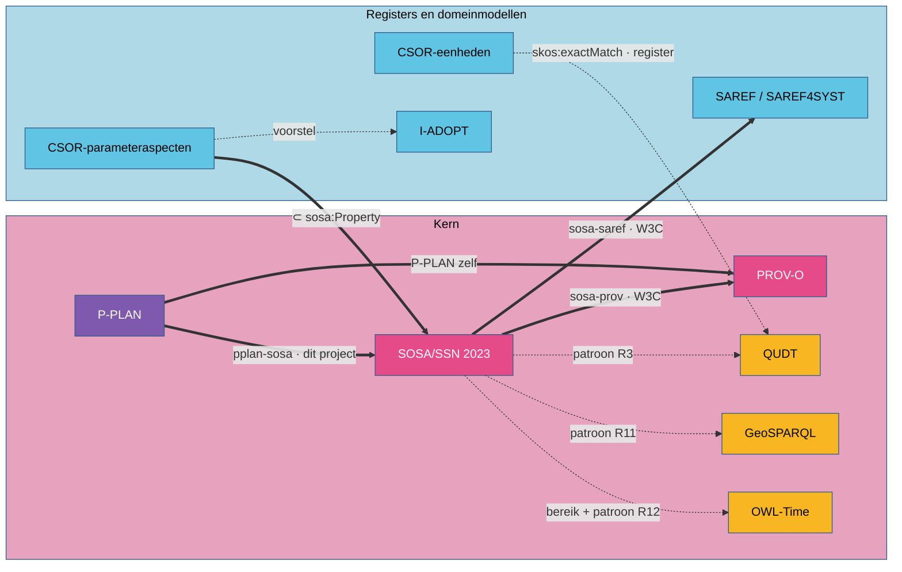

# II. Samenhang: hoe de vocabularia op elkaar aansluiten

Zes vocabularia naast elkaar zijn nog geen model. Ze worden er een door **alignments**: uitspraken
die een begrip van het ene vocabularium verbinden met een begrip van het andere. *Een waarneming
is een PROV-activiteit.* *Het resultaat van een waarneming wordt door die waarneming gegenereerd.*
*Een stap uit een plan is een procedure.* Dit hoofdstuk is het hart van het werk: wie de
alignments begrijpt, begrijpt waarom de [regels](../regels/index.md) zijn wat ze zijn.

## Overzicht

Een **dikke pijl** is een formele uitlijning: OWL-axioma's in een gepubliceerd bestand, die een
redeneerder kan gebruiken. Een **stippellijn** is een afspraak: de vocabularia passen samen, maar
de koppeling ligt in de manier waarop je ze gebruikt, niet in een axioma.

| Hoofdstuk | Soort | Kern | Gepubliceerd door |
|---|---|---|---|
| [SOSA en PROV-O](sosa-prov.md) | formeel | uitvoeringen zijn activiteiten; studieobjecten, monsters, eigenschappen en platformen zijn entiteiten; het resultaat wordt gegenereerd, het studieobject en de inputwaarde gebruikt | W3C (module `sosa-prov` van SSN/SOSA 2023) |
| [P-PLAN en SOSA](pplan-sosa.md) | formeel | plannen en stappen zijn procedures; ketens van variabelen naar procedure | dit project (`pplan-sosa.ttl`) |
| [SOSA en QUDT](sosa-qudt.md) | afspraak | het resultaat is een `qudt:QuantityValue` met getal en eenheid | regel R3 |
| [SOSA en GeoSPARQL](sosa-geosparql.md) | afspraak, met een domein | een studieobject met een plaats is een `geo:Feature` met een geometrie | regel R11 |
| [SOSA en OWL-Time](sosa-time.md) | bereik en afspraak | de fenomeentijd is een OWL-Time-entiteit: tijdstip of interval | SOSA (bereik), regel R12 |
| [Register en QUDT](register-qudt.md) | mapping in het register | een CSOR-eenheid verwijst met `skos:exactMatch` naar een QUDT-eenheid | het register (CSOR) |
| [Register en I-ADOPT](register-iadopt.md) | voorstel | een parameteraspect is een I-ADOPT-variabele | analyse in dit project |
| [SOSA en SAREF](sosa-saref.md) | formeel | systemen, eigenschappen, uitvoeringen gelijkgesteld met SAREF | W3C (module `sosa-saref`) |

## Een alignment lezen

Een alignment bestaat uit een handvol soorten axioma's. Elk heeft een eigen gevolg.

| Axioma | Voorbeeld | Wat een redeneerder eruit afleidt |
|---|---|---|
| `rdfs:subClassOf` | `sosa:Observation rdfs:subClassOf prov:Activity` | elke waarneming is ook een activiteit; een PROV-query vindt ze |
| `rdfs:subPropertyOf` | `sosa:hasResult rdfs:subPropertyOf prov:generated` | uit *waarneming heeft resultaat r* volgt *waarneming genereerde r*, met domein en bereik van `prov:generated` erbij |
| `owl:equivalentClass` / `owl:equivalentProperty` | `sosa:Observation owl:equivalentClass saref:Observation` | beide namen zijn uitwisselbaar |
| `owl:propertyChainAxiom` | `sosa:usedProcedure` ← `p-plan:correspondsToStep` ∘ `p-plan:isDecomposedAsPlan` | een eigenschap volgt uit een pad van andere |
| `owl:disjointWith` | `prov:Activity owl:disjointWith prov:Entity` | niets is beide; een resource die beide wordt, maakt het model **inconsistent** |

Het laatste axioma is wat alignments zo waardevol maakt. Een subklasse of subproperty voegt
afgeleide feiten toe; samen met een disjunctie maakt ze **fouten aantoonbaar**. Wie een waarneming
als inputwaarde van een andere waarneming opgeeft, maakt ze via de alignment tot entiteit, terwijl
ze als waarneming een activiteit is. Dat is een tegenspraak, geen kwestie van smaak.

!!! hulpmiddel "Afgeleide feiten zichtbaar maken"
    Een redeneerder met regels voor domein, bereik, subklasse en subproperty (RDFS-niveau) volstaat
    voor de meeste gevolgen in dit hoofdstuk; samen met een controle op disjuncte klassen vindt hij
    de fouten. Ketens van eigenschappen (`owl:propertyChainAxiom`) vragen een OWL 2 RL- of
    DL-redeneerder. De [bijlage Hulpmiddelen](../bijlagen/hulpmiddelen.md) toont hoe de validatie in
    dit project dat doet.

## Wat een alignment niet doet

- **Het verplicht niets.** OWL is open: dat een waarneming een activiteit *is*, betekent niet dat
  je ze ook zo moet typeren, en een ontbrekende eigenschap is in OWL nooit een fout. Verplichtingen
  komen uit een toepassingsprofiel (SHACL), niet uit een alignment.
- **Het staat niet altijd in een van beide vocabularia.** De uitlijning van SOSA met SAREF is een
  aparte module van SSN/SOSA 2023, niet van SAREF; het register van Linked Open Vocabularies kent
  ze niet. Afwezigheid in een vocabularium bewijst dus niet dat er geen alignment is
  ([Een alignment vinden en beoordelen](alignment-vinden.md)).
- **Het is niet altijd normatief.** De PROV-module van SSN/SOSA 2023 is een niet-normatieve
  bijlage van de specificatie. Ze wordt in dit werk toch als fundament gebruikt, omdat ze de
  lezing vastlegt die de definities van SOSA zelf al maken.
