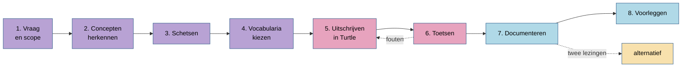

# VI. Werkwijze: van vraag tot gedragen model

Acht stappen, van de eerste vraag tot een model dat een werkgroep kan beslissen. Elke stap kan
met pen en papier; waar een hulpmiddel helpt, staat het in een kader. Daarna volgen trajecten voor
situaties die vaak voorkomen: een ontvangen mapping herzien, een alternatief uitwerken, een grote
dataset in fases mappen, een ontologie ontwerpen, twee modellen aligneren, een beslisdocument
schrijven.



## 1. Vraag en scope

Begin bij de **vraag** die de data moet beantwoorden, en bij de **eigenaar** van de data. Vraag
wat eerst telt en wat niet nu. Typisch: eerst de gemeten resultaten; normen, beoordelingen en
interpretaties later; volledige beschrijvingen van bedrijven, stations en andere objecten enkel
voor zover ze nodig zijn als studieobject of identificatie. Schrijf de scope op, met wie het zei
en wanneer.

Beslis ook de **soort voorbeeld**: een nieuw model, een herziening van een ontvangen mapping
([traject](herzien.md)), of een alternatief naast een bestaand model ([traject](alternatief.md)).

## 2. Concepten herkennen

Neem een paar echte records en beantwoord per record de vragen van
[III. Modelleren](../modelleren/index.md):

| Vraag | Antwoord voor dit record |
|---|---|
| Waarover gaat de waarde? (studieobject, monster, uiteindelijk studieobject) | |
| Welke eigenschap? | |
| Wie of wat bepaalde ze, volgens welke werkwijze? | |
| Welke waarde, in welke eenheid? Onder een grens? | |
| Wanneer: tijdstip of periode, met welke tijdzone? | |
| Waar: coördinaten, adres, groter gebied? | |
| Berekend uit andere waarden? | |
| Meerdere stappen, hergebruik, traceerbaarheid? ([R4](../regels/r04.md)) | |

Kijk naar de [patronen](../patronen/index.md): past er een? Kijk naar de
[casussen](../casussen/index.md): is een vergelijkbaar domein al uitgewerkt?

## 3. Schetsen

Teken één representatieve waarneming, met al haar verbanden, in de drie lagen van het platte model
(procedure, infrastructuur, waarneming) of de drie van het drielaagse (planning, inzet,
uitvoering). Gebruik de [kleurconventie](diagrammen.md). Een schets op papier volstaat; ze
dwingt keuzes af die in tekst verborgen blijven.

## 4. Vocabularia kiezen

Alles wat de kern kan uitdrukken, drukt de kern uit. Voor wat overblijft: zoek in de volgorde van
[R17](../regels/r17.md), zoek alignments, beoordeel op de criteria, en noteer de vergelijking
([Een alignment vinden en beoordelen](../kaart/alignment-vinden.md)). Zoek ook naar registers
voor eigenschappen, eenheden en studieobjecten ([Codelijsten en registers](../modelleren/codelijsten.md)).

!!! hulpmiddel "Termen opzoeken"
    Zoek elke klasse, eigenschap en elk vocabulariumobject (ook eenheden) op voor je het gebruikt,
    met de volledige IRI, en kijk naar domein en bereik. Een term die niet bestaat, verzin je niet;
    een verouderde term vervang je. De [validatieserver](../bijlagen/hulpmiddelen.md) heeft
    opzoek- en zoekfuncties op alle geladen vocabularia.

## 5. Uitschrijven in Turtle

Schrijf het bestand in blokken, met een commentaarkop per blok:

```turtle
### INFRASTRUCTUUR
# sosa:Platform, sosa:Sensor / sosa:Actuator

### PROCEDURE EN EIGENSCHAPPEN
# sosa:ObservingProcedure, sosa:Property

### WAARNEMINGEN
# sosa:ObservationCollection, sosa:Observation, qudt:QuantityValue
```

Voor een drielaags model: `### PLANNING`, `### DEPLOYMENT`, `### EXECUTION`, met een prefix per
laag. Pas de regels toe, in het bijzonder [R2](../regels/r02.md), [R3](../regels/r03.md),
[R7](../regels/r07.md)/[R13](../regels/r13.md), [R10](../regels/r10.md), [R11](../regels/r11.md),
[R12](../regels/r12.md), [R14](../regels/r14.md) en [R16](../regels/r16.md).

Gaat het om echte data van een eigenaar, script dan de omzetting ([Brondata in fases mappen](brondata.md)).

## 6. Toetsen

Toets het model op drie niveaus:

1. **Bestaan de termen?** Elke term bestaat in het vocabularium dat hij noemt, met de juiste
   schrijfwijze, `http`/`https` en `#`/`/`.
2. **Is het consistent?** Na afleiding met domein, bereik en subklassen: geen resource die
   tegelijk activiteit en entiteit is, of feature en geometrie ([II. De kaart](../kaart/index.md)).
3. **Voldoet het aan de regels en het profiel?** Verplichte eigenschappen aanwezig, juiste types
   ([IV. Regels](../regels/index.md)).

!!! hulpmiddel "Automatisch toetsen"
    De validatieserver van dit project doet alle drie in één keer en geeft een rapport met
    `[error]`, `[suspect]` en `[warning]`. Elke fout wordt opgelost; een vermoeden wordt
    nagekeken; een waarschuwing mag blijven als de bron de informatie niet heeft, vermeld in de
    bespreking ([Hulpmiddelen](../bijlagen/hulpmiddelen.md)).

## 7. Documenteren

Elk model krijgt:

- een **README**: bron, transformatie, keuzes in het kort, diagram, uitvoer, gebruik;
- een **diagram** volgens de [conventies](diagrammen.md);
- een **bespreking** in [negen vragen](bespreking.md), met per niet-triviale keuze de verworpen
  alternatieven en de reden;
- optioneel een **oefening** ([VIII. Oefenen](../oefenen/index.md)).

Een open vraag wordt een concrete vraag, nooit een algemene plaatshouder:

```markdown
<!-- TODO: is de meetput hetzelfde object als het lozingspunt in RIE-IEPR? -->
```

**Twee verdedigbare lezingen?** Kies niet stil. Modelleer de hoofdlezing, noteer de andere als
verworpen alternatief in de bespreking, en stel een [alternatief](alternatief.md) voor.

## 8. Voorleggen

Een model voor een domein wordt in Vlaanderen vastgelegd in een OSLO-traject. Leg het voor als
**uitgewerkt voorstel**, niet als open vragenlijst: per beslispunt de vraag, het voorstel zoals in
de voorbeelden, de verworpen alternatieven, de gevolgen, de status
([Het beslisdocument](beslisdocument.md)).
