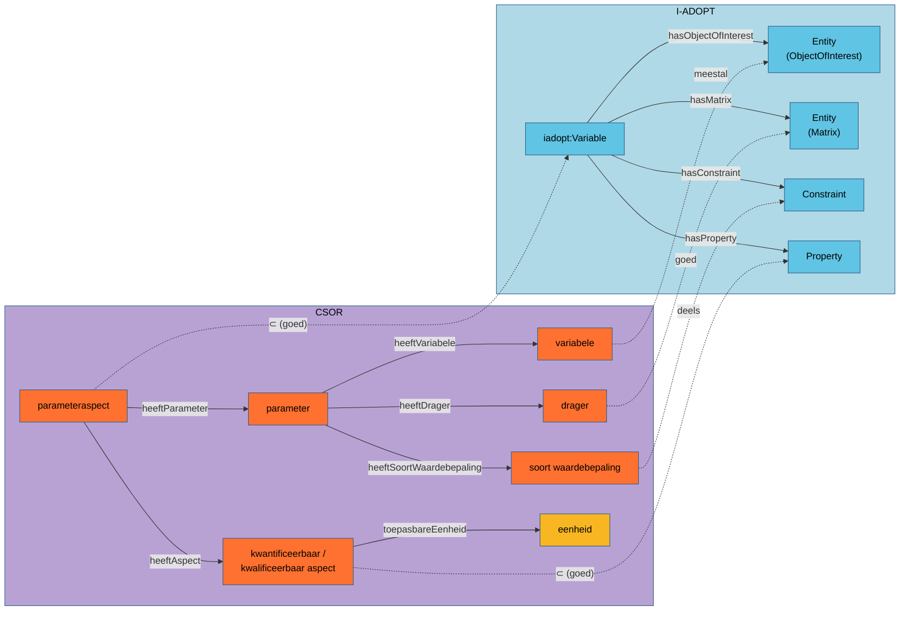

# CSOR en I-ADOPT: analyse van de alignering

Deze analyse vergelijkt het model van het CSO-register (CSOR, `~/git/csor`) met het I-ADOPT
Framework (`https://i-adopt.github.io/ontology/`). De vraag is of het CSOR-parameteraspect, dat in
het waterkwaliteitmodel `sosa:observedProperty` is (`beslisdocument.md` A1), ook als I-ADOPT-variabele
beschreven kan worden, en wat daarvoor in CSOR moet veranderen.

*Opgesteld 2026-10-05. I-ADOPT 1.1.0 (2025-05-28). CSOR: de lokale kopieën van de codelijsten in
`~/git/csor/codelijst-csor-*` en de ontologie in
`src/main/resources/be/vlaanderen/omgeving/data/ns/csor/csor.ttl`. Alle cijfers tellen enkel de
niet-verouderde concepten (`owl:deprecated false`).*

---

## 1. Samenvatting

- **Het parameteraspect is een I-ADOPT-variabele.** Het combineert precies één grootheid
  (kwantificeerbaar of kwalificeerbaar aspect) met wat gemeten wordt (variabele), in een matrix
  (drager), eventueel met een beperking (soort waardebepaling). Dat is de I-ADOPT-opbouw. I-ADOPT
  bevestigt dus de keuze van A1: niet de parameter en niet de variabele, maar het parameteraspect
  is het juiste niveau voor `sosa:observedProperty`.
- **De CSOR-facetten passen maar deels op de I-ADOPT-rollen.** De drager (matrix) en het
  kwantificeerbaar aspect (eigenschap) passen goed. Twee facetten wijken af:
  - De *variabele* is meestal een stof (ObjectOfInterest). Soms is ze zelf een eigenschap:
    `Debiet`, `Temperatuur`, `pH`, `Geleidbaarheid (20°C)`.
  - De *soort waardebepaling* is een mengvorm. Ze bevat beperkingen (opgelost, totaal) maar ook
    voorbehandelingen, staalnametoestellen, analysemethoden en projecten. I-ADOPT sluit methoden
    en toestellen expliciet uit de variabele uit.
- **Voor de waterkwaliteitsdata is de aansluiting goed.** Van de 452 gebruikte parameteraspecten
  zijn er 347 (77 %) eenvoudig om te zetten: een stof, zonder beperking, met een zuivere
  grootheid. De rest vraagt een stofgroep (`iadopt:SymmetricSystem`), een beperking
  (`opgelost`/`totaal`), of een andere verdeling van de rollen (eigenschappen als variabele).
- **Voorstel** (§7): in CSOR de klassen aligneren (`csor:ParameterAspect` ⊂ `iadopt:Variable`,
  aspecten ⊂ `iadopt:Property`) en de I-ADOPT-beschrijving per parameteraspect genereren waar
  ze eenduidig is. De herstructurering van de soort waardebepaling hoort bij het CSOR-beheer (C1).
  Voor fase 2 (normen) biedt `iadopt:StatisticalModifier` een uitweg voor jaargemiddelden en
  maxima (§6.4).
- **Toets per element** (§9, toegevoegd 2026-10-08): 336 van de 8179 actieve parameteraspecten
  bevatten minstens één element dat niet op zijn plaats staat. Het gaat om 102 variabelen (bv.
  eigenschappen, toetsen, rekenregels), 34 waarden van de soort waardebepaling (methoden,
  toestellen, projecten) en 16 aspecten. 22 parameteraspecten hebben een aspect waarvan de
  dimensie niet bij de variabele past, bv. `T (standaard in water): massaconcentratie`. In de
  waterkwaliteitsvoorbeelden zijn 7 van de 452 parameteraspecten betrokken: debiet, temperatuur,
  pH, geleidbaarheid en volume. Geen ervan maakt een observatie dubbelzinnig, maar twee hebben
  een misleidend CSOR-label (§9.5). De definities in `csor.ttl` zeggen nu ook wat er níet in een klasse
  hoort. De alignering met I-ADOPT staat er als voorstel in.

---

## 2. I-ADOPT in het kort

I-ADOPT is het resultaat van de RDA-werkgroep *InteroperAble Descriptions of Observable Property
Terminology*. Het ontleedt een variabele ("wat geobserveerd of afgeleid wordt") in componenten die
elk naar een FAIR-vocabularium verwijzen.

| Klasse / property | Betekenis |
|---|---|
| `iadopt:Variable` | Beschrijving van wat geobserveerd of afgeleid wordt. In OWL **equivalent** met "precies één `hasObjectOfInterest` (Entity)" en met "precies één `hasProperty` (Property)". |
| `iadopt:hasProperty` → `iadopt:Property` | de grootheid of eigenschap ("type of a characteristic of the ObjectOfInterest") |
| `iadopt:hasObjectOfInterest` → `iadopt:Entity` | het ding waarvan de eigenschap geobserveerd wordt (bv. de stof) |
| `iadopt:hasMatrix` (⊂ `hasContextObject`) → `iadopt:Entity` | waarin het ObjectOfInterest zich bevindt (water, lucht, bodem) |
| `iadopt:hasContextObject` → `iadopt:Entity` | bijkomende context voor het ObjectOfInterest |
| `iadopt:hasConstraint` → `iadopt:Constraint`, met `iadopt:constrains` | beperkt een component (Entity, Property of StatisticalModifier) tot een bepaalde toestand (bv. opgelost) |
| `iadopt:hasStatisticalModifier` → `iadopt:StatisticalModifier` | toegepaste statistiek (gemiddelde, maximum, standaarddeviatie); nieuw in 1.1 |
| `iadopt:System` ⊂ `Entity`: `SymmetricSystem` (`hasPart`, minstens twee) en `AsymmetricSystem` (`hasNumerator`/`hasDenominator`, `hasSource`/`hasTarget`) | samengestelde entiteiten: sommen van stoffen, verhoudingen, fluxen |
| `iadopt:VariableSet` (`hasApplicableProperty`, `hasApplicableObjectOfInterest`, `hasApplicableMatrix`, …) | groepeert variabelen met een gemeenschappelijk doel |

**Buiten de scope van I-ADOPT:** "The framework does not capture units, instruments, methods, and
geographical location information". Eenheid, methode en toestel horen dus niet in de variabele,
maar in de observatie (resultaat, procedure, sensor).

**Namespace.** De termen hebben de vorm `https://w3id.org/iadopt/ont/<Term>` (slash). Het
standaardprefix in de Turtle-publicatie (`https://w3id.org/iadopt/ont#`) wordt voor geen enkele term
gebruikt. De CSOR-README's en `~/git/csor/test.ttl` declareren `iadopt: <https://w3id.org/iadopt/ont/>`.
Dat is juist, maar **geen enkele CSOR-codelijst gebruikt vandaag een I-ADOPT-term**.

**Alignering met SOSA.** I-ADOPT bevat zelf geen aligneringen met SOSA/SSN of QUDT.

---

## 3. Structurele vergelijking



| CSOR | Aantal (actief) | I-ADOPT | Overeenkomst |
|---|---|---|---|
| `csor:ParameterAspect` | 8179 | `iadopt:Variable` | **goed.** Precies één aspect (= Property). De ObjectOfInterest, matrix en beperking komen via de parameter. |
| `csor:Parameter` | 4564 | geen eigen klasse; hoogstens `iadopt:VariableSet` | **geen.** Een parameter heeft geen grootheid en is dus geen `iadopt:Variable` (die vraagt precies één Property). Met haar parameteraspecten past ze als `VariableSet` met `hasApplicableObjectOfInterest`, `hasApplicableMatrix` en `hasApplicableProperty`. |
| `csor:Variabele` | 1887 | `iadopt:Entity` in de rol ObjectOfInterest | **meestal.** 1279 variabelen hebben een CAS-nummer of InChIKey (stoffen). De overige 608 zijn stofgroepen, sommen, taxa, groepsparameters en eigenschappen (§5.1, §5.2). |
| `csor:Drager` | 12 (11 in gebruik) | `iadopt:Entity` in de rol Matrix | **goed** voor water, lucht, vaste deel van de aarde en biota. Afwijkingen in §5.5. |
| `csor:SoortWaardebepaling` | 80 | `iadopt:Constraint` | **deels.** 30 van de 80 waarden zijn beperkingen. De rest zijn procedures, toestellen, statistiek of projecten (§5.4). |
| `csor:KwantificeerbaarAspect` | 139 | `iadopt:Property` | **goed**, maar soms met een ingebedde basis of uitdrukking ("massaconcentratie fosfor", "per droge stof", "(Nm³)") (§5.3). |
| `csor:KwalificeerbaarAspect` | 3 (Aantoonbaarheid, Aanwezigheid, Sterkte van aanwezigheid) | `iadopt:Property` | **goed.** |
| `csor:Eenheid`, `csor:NatuurkundigeDimensie` | 360 / 49 | buiten I-ADOPT | De eenheid staat in het resultaat (`qudt:hasUnit`, A2). De natuurkundige dimensie komt overeen met `qudt:QuantityKind`. CSOR legt met `csor:toepasbareEenheid` meer vast dan I-ADOPT, en dat is een meerwaarde. |
| `csor:ParameterAfleiding*`, `csor:ParameterAspectOmzetting` | 130 parameters met afleiding | buiten I-ADOPT | Dat zijn rekenregels, geen beschrijvingen. Een veelterm-afleiding (som) geeft wel de delen van een `iadopt:SymmetricSystem` (§5.2). |

**Het pad verschilt.** In I-ADOPT hangen alle componenten rechtstreeks aan de variabele. In CSOR
hangen variabele, drager en soort waardebepaling aan de *parameter*, en het aspect aan het
*parameteraspect*. Alleen `csor:heeftAspect` kan daarom rechtstreeks een sub-property van
`iadopt:hasProperty` zijn. De andere componenten volgen een keten van twee stappen
(`csor:heeftParameter` / `csor:heeftVariabele`). Dat bepaalt de vorm van de alignering in §7.

---

## 4. Kwantitatieve toets

Elk parameteraspect is ingedeeld volgens drie vragen:
1. Is de variabele een stof (CAS of InChIKey)?
2. Is de soort waardebepaling `standaard` (dus geen beperking)?
3. Is het aspect een zuivere grootheid, zonder ingebedde basis of uitdrukking?

| | Alle actieve parameteraspecten | Gebruikt in de waterkwaliteitsvoorbeelden |
|---|---|---|
| Aantal | 8179 | 452 |
| Variabele = stof (CAS/InChIKey) | 6422 (79 %) | 410 (91 %) |
| Soort waardebepaling `standaard` | 6800 (83 %) | 392 (87 %) |
| Aspect met ingebedde basis of uitdrukking | 1923 (24 %) | 17 (4 %) |
| **Eenvoudig om te zetten** (stof, `standaard`, zuivere grootheid) | **3883 (47 %)** | **347 (77 %)** |
| Drager | water 4167, vaste deel van de aarde 1620, lucht 875, materiaal 641, … | water 452 |
| Soort waardebepaling ≠ `standaard` | Eluaat LS10 334, totaal 287, opgelost 166, multi totaal 135, … | opgelost 28, totaal 28, 4 andere |

De gebruikte parameteraspecten staan in `nieuw_model/*/*.trig`. De waterdata zit in het gunstige
deel van CSOR. De moeilijke gevallen (eluaten, deposities, ecotoxicologie, emissies in Nm³) komen
uit bodem-, lucht- en afvalstoffenmetingen.

---

## 5. Knelpunten per component

### 5.1 Eigenschappen als variabele

Bij fysische en groepsparameters staat de *eigenschap* in de variabele. Voorbeelden uit de
voorbeelden: `Debiet`, `Temperatuur`, `pH`, `Geleidbaarheid (20°C)`, `Geleidbaarheid (25°C)`,
`Hardheid`, `Volume`. Elders in CSOR: `Minimale Temperatuur`, `Maximale Temperatuur`,
`Bemonsteringsdiepte`, `Dikte`, `Kleur`, `Doorzichtigheid`.

In I-ADOPT is de ObjectOfInterest dan **de matrix zelf**. De eigenschap is de Property:

| CSOR (PAS_1839) | I-ADOPT |
|---|---|
| variabele `Debiet` (V_684), drager `water`, aspect `debiet (vracht)` (KWA_10) | ObjectOfInterest = water, Property = debiet (volume per periode) |
| variabele `Geleidbaarheid (20°C)`, drager `water`, aspect `geleidbaarheid` | ObjectOfInterest = water, Property = elektrische geleidbaarheid, Constraint "bij 20 °C" op de Property |
| variabele `Maximale Temperatuur` | Property = temperatuur, StatisticalModifier = maximum |

De eigenschap staat bij PAS_1839 dus **tweemaal** in het parameteraspect: in de variabele en in
het aspect. Een automatische omzetting zou `Debiet` als `iadopt:Entity` typeren, en dat is fout.
Voor een correcte omzetting moet CSOR deze variabelen markeren. Dat kan bijvoorbeeld met een
`dct:type` op de variabele (stof, stofgroep, taxon, eigenschap, groepsparameter). Bij een
eigenschap wordt de drager dan ObjectOfInterest in plaats van matrix.

Groepsparameters die door de methode bepaald zijn (`Chemisch zuurstofverbruik`, `Biochemisch
zuurstofverbruik na 5d.`, `Kjeldahlstikstof`, `Zwevende stoffen`) vallen ertussen. Een
pragmatische lezing: ObjectOfInterest = water (of de zwevende stof), Property = de
methodegedefinieerde grootheid.

### 5.2 Stofgroepen en sommen

Voorbeelden: `Som van de 43 PFAS`, `Nitraat+nitriet`, `Aldrin+Dieldrin+Endrin+Isodrin`,
`2,4+2,5-Dichloorfenol`, `Totaal perfluoroctaanzuur (lineair + vertakt)`, `Xylenen (m+p)`. In
I-ADOPT is dat een `iadopt:SymmetricSystem` met `iadopt:hasPart` naar de afzonderlijke stoffen,
mits die als CSOR-variabele bestaan.

Voor de 130 parameters met een veelterm-afleiding liggen de delen al in CSOR vast
(`csor:heeftTerm` → `csor:heeftBronParameter`). Het `SymmetricSystem` is daaruit af te leiden.

Twee soorten blijven over:
- groepen zonder opgesomde leden (`Chloorfenolen`, `Polyaromatische KWS (6 Borneff)`), die
  `iadopt:Entity` blijven met een definitie;
- verschillen (`= PFOAtotaal - PFOA`). Dat zijn rekenregels, geen entiteiten, en ze vallen
  buiten I-ADOPT.

### 5.3 Ingebedde componenten in het kwantificeerbaar aspect

In 1923 parameteraspecten draagt het aspect meer dan een grootheid:

| Patroon in het aspect | Voorbeeld | I-ADOPT |
|---|---|---|
| uitgedrukt als element (`csor:uitgedruktIn`) | `massaconcentratie fosfor` (PAS_2163 "P t (totaal in water)"), `massaconcentratie stikstof` | Constraint "uitgedrukt als P" op de Property, of (bij nitraat als N) een Constraint op de ObjectOfInterest. I-ADOPT heeft hiervoor geen vast patroon; de gebruiksaanbevelingen zijn de referentie. |
| basis van de matrix | `massaverhouding per droge stof`, `… per nat gewicht` | Constraint "droog" / "nat" op de matrix |
| referentiecondities | `massaconcentratie (Nm³)` | Constraint "normaalcondities" op de matrix (rookgas) |
| gewogen som | `massaconcentratie TEQ`, `massa WHO-TEQ per massa` | eigen Property (toxisch equivalent), met een `SymmetricSystem` als ObjectOfInterest |

CSOR heeft per combinatie een apart aspect gemaakt (106 aspecten in gebruik). I-ADOPT ontleedt
dat in een algemene Property plus een Constraint. Beide leiden tot een eenduidige variabele.
CSOR moet daarvoor niet herstructureren: het volstaat dat de I-ADOPT-beschrijving van het aspect
de Constraint vermeldt.

### 5.4 Soort waardebepaling: een mengvorm

Indeling van de 80 waarden over de 4564 actieve parameters:

| Categorie | Parameters | Waarden | Voorbeelden | Plaats volgens I-ADOPT / SOSA |
|---|---|---|---|---|
| geen beperking | 3663 | 1 | `standaard` | geen Constraint |
| fractie of vorm | 472 | 30 | `opgelost`, `totaal`, `gefilterd`, `organisch`, `anorganisch`, `vrij`, `elementair`, `vluchtig`, `enkel gasvormig`, `adsorbeerbaar`, `purgeerbaar` | **`iadopt:Constraint`** op de ObjectOfInterest of de matrix |
| voorbehandeling | 340 | 15 | `Eluaat LS10` (uitloogtest L/S = 10), `na Zahn Wellens`, `extraheerbaar`, `vrijstelbaar in zwak zuur` | grensgeval. Bepaalt mee *wat* gemeten wordt (de uitloogbare fractie), dus verdedigbaar als Constraint. De test zelf is een `sosa:Procedure`. |
| staalnametoestel | 45 | 1 | `pesticiden sampler` | **niet in de variabele**: `sosa:Sampler` / `sosa:Procedure` van de staalname |
| ecotoxicologisch eindpunt / duur | 26 | 21 | `EC50 (48h)`, `LC50 (96h)`, `groei-inhibitie`, `72h` | Property (EC50, LC50) + Constraint (blootstellingsduur); het testorganisme (bv. `Daphnia magna`, nu een variabele) is een ContextObject |
| project | 12 | 8 | `MUC project`, `MUCd project totaal` | **niet in de variabele**: provenance (`prov:wasGeneratedBy`, `dct:source`) |
| analysemethode | 3 | 2 | `GC-MS`, `LC-MS` | **niet in de variabele**: `sosa:usedProcedure` (A10) |
| statistiek / berekening | 3 | 2 | `standaard deviatie`, `Nieuwe indexberekening` | `iadopt:StatisticalModifier`; de indexberekening is een procedure |

De soort waardebepaling bundelt dus drie lagen die SOSA en I-ADOPT scheiden: *wat* gemeten wordt
(Constraint), *hoe* (procedure, toestel) en *in welke context* (project). Voor de 3663 parameters
met `standaard`, en de 472 met een fractie, levert dat geen probleem op. Voor de overige 429
parameters bevat de CSOR-identiteit informatie die volgens I-ADOPT in de observatie hoort.

**Gevolg voor het waterkwaliteitmodel.** Twee parameters die enkel in methode of project
verschillen (bv. `X (GC-MS in water)` en `X (LC-MS in water)`) zijn in CSOR twee
observedProperties. Volgens I-ADOPT/SOSA zijn ze één observedProperty met twee procedures. In de
waterkwaliteitsvoorbeelden komt dat niet voor (enkel `standaard`, `opgelost`, `totaal`,
`adsorbeerbaar`, `organisch opgelost`, `verzadiging`, `gefilterd`).

### 5.5 Drager

`water`, `lucht`, `vaste deel van de aarde` en `biota` zijn matrices. Vier gevallen wijken af:
- `PM10`, `PM2.5` en `TSP` zijn deeltjesfracties *in* lucht. In I-ADOPT is de matrix PM10, met
  lucht als ContextObject (of een Constraint "deeltjesgrootte < 10 µm" op de matrix). Dat is een
  geldige matrix (bv. lood in PM10). PM10 staat ook als variabele in CSOR (V_1901, voor de
  massaconcentratie PM10 in lucht). Daar is PM10 het ObjectOfInterest. Beide gebruiken kloppen
  (§9.3).
- `bulk depositie (precip)` en `wet-only depositie (prec)` zijn een proces met een
  staalnamewijze. De matrix is neerslag. "Bulk" of "wet-only" is een Constraint, of een
  staalnameprocedure.
- `passiveSamplingFilter` is een staalnametoestel, geen matrix. Geen actieve parameter gebruikt
  het; het hoort bij de staalnameprocedure (`sosa:Sampler`).
- `materiaal` is geen afgebakende matrix. Je kunt het niet aan een extern vocabularium koppelen
  zonder te weten welk materiaal bedoeld is.

**Granulariteit tegenover het SOSA-model.** De drager is `water`. Het waterkwaliteitmodel zet de
specifieke matrix (`afvalwater`, `oppervlaktewater` uit `codelijst-matrix`) op het FOI (A5). Dat
is consistent met I-ADOPT: de variabele noemt de matrix op het algemene niveau dat de grootheid
bepaalt. De specifieke matrix is een kenmerk van het staal. Zou je `afvalwater` in de variabele
zetten, dan verdubbelt het aantal observedProperties zonder dat de grootheid verandert.

### 5.6 Vracht en debiet: flux

I-ADOPT beschrijft een flux met een `iadopt:AsymmetricSystem` met `hasSource` en `hasTarget`, bv.
"PFOS-vracht van lozing X naar waterloop Y". CSOR heeft een vracht (`vracht`,
`vracht per tijd`, `KWA_10 debiet (vracht)`) zonder bron of doel.

In het SOSA-model is de bron het FOI (`wk:Emissie`, A4/A8). Het doel is een kenmerk van het
lozingspunt (lozingswijze, ontvangend water: fase 3). Bron en doel horen dus niet in de
variabele. Een generieke `iadopt:Variable` "vracht van PFOS in water" volstaat, en zo blijft het
aantal observedProperties beheersbaar.

---

## 6. Gevolgen voor het waterkwaliteitmodel

### 6.1 A1: bevestigd

`sosa:observedProperty` = CSOR-parameteraspect blijft het voorstel. I-ADOPT geeft er een
internationaal argument bij: het parameteraspect is het enige CSOR-niveau dat aan de definitie
van `iadopt:Variable` voldoet (precies één ObjectOfInterest, precies één Property). De
verworpen alternatieven van A1 (parameter, stof-IRI) zijn in I-ADOPT-termen onvolledige
variabelen: de parameter mist de Property, de stof-IRI mist Property en matrix.

Een parameteraspect is dan tegelijk `sosa:Property` (A1), `iadopt:Variable` en `skos:Concept`.
Die typeringen spreken elkaar niet tegen.

### 6.2 A2: bevestigd

I-ADOPT sluit eenheden uit de variabele uit. De eenheid staat op het resultaat, en CSOR beperkt
via `csor:toepasbareEenheid` welke eenheden toegelaten zijn. Dat sluit aan.

### 6.3 A10: procedures

Methoden en toestellen horen in `sosa:usedProcedure` en `sosa:madeBySensor`/`sosa:Sampler`.
Waar CSOR ze in de soort waardebepaling heeft, levert de data ze dubbel aan. Het model moet de
procedure dan toch expliciet op de observatie zetten; dat is geen leemte in het model.

### 6.4 Fase 2: normen en beoordelingen (D1)

`250124` toetst jaarwaarden aan normen met toetswijze `MAX` (126 van 127 normen) of `MIN`.
- Een norm is een grenswaarde voor een **statistiek** van een variabele: het maximum of het
  jaargemiddelde van de PFOS-massaconcentratie in water.
- CSOR heeft daar geen parameteraspecten voor, op enkele uitzonderingen na (`Minimale Temperatuur`,
  `standaard deviatie`).
- Twee opties:
  - nieuwe CSOR-parameteraspecten per statistiek (dat verveelvoudigt het register);
  - een I-ADOPT-variabele die het CSOR-parameteraspect hergebruikt en een
    `iadopt:StatisticalModifier` toevoegt (maximum, jaargemiddelde).
- **Voorstel voor D1:** de tweede optie. De jaarwaarde in `Beoordeling_Vlarem_Trigger.json`
  (`Meting`) wordt dan een afgeleide observatie (R13) met als observedProperty
  "maximum van PAS_x over het jaar".

```turtle
ex:variabele-pfos-waterbodem-max a iadopt:Variable, sosa:Property ;
    rdfs:label "PFOS (standaard in vaste deel van de aarde): massaverhouding per droge stof, maximum"@nl ;
    prov:wasDerivedFrom csor-pa:PAS_xxxx ;               # het CSOR-parameteraspect
    iadopt:hasObjectOfInterest csor-var:V_962 ;           # PFOS
    iadopt:hasMatrix csor-dr:DR_3 ;                       # vaste deel van de aarde (waterbodem)
    iadopt:hasProperty csor-kwa:KWA_x ;                   # massaverhouding per droge stof
    iadopt:hasStatisticalModifier ex:maximum .
```

*(`PAS_xxxx` en `KWA_x` op te zoeken bij de mapping van `250124`.)*

---

## 7. Voorstel voor de alignering

### 7.1 Klassen en een directe property (in de CSOR-ontologie)

*Opgenomen als voorstel in `src/main/resources/be/vlaanderen/omgeving/data/ns/csor/csor.ttl`,
sectie I-ADOPT-ALIGNERING (2026-10-08), samen met de deelklassen van §9.6.*

```turtle
csor:ParameterAspect        rdfs:subClassOf iadopt:Variable .
csor:KwantificeerbaarAspect rdfs:subClassOf iadopt:Property .
csor:KwalificeerbaarAspect  rdfs:subClassOf iadopt:Property .
csor:heeftAspect            rdfs:subPropertyOf iadopt:hasProperty .
```

- Dit sluit aan bij de projectregel: klassen aligneren met `rdfs:subClassOf`, niet met
  `skos:*Match`.
- `csor:heeftAspect` heeft al precies één waarde per parameteraspect, en het bereik
  (kwantificeerbaar ∪ kwalificeerbaar aspect) valt dan onder `iadopt:Property`.
- Bewust **niet**:
  - `csor:Variabele ⊂ iadopt:Entity`: een deel van de variabelen is een eigenschap (§5.1);
  - `csor:SoortWaardebepaling ⊂ iadopt:Constraint`: de helft van de waarden is geen beperking
    (§5.4);
  - `csor:Parameter ⊂ iadopt:Variable`: een parameter heeft geen Property.
- **Let op de equivalentie.** `iadopt:Variable` is equivalent met "precies één ObjectOfInterest".
  Een OWL-redeneerder leidt dan voor elk parameteraspect af dat er een ObjectOfInterest *bestaat*,
  ook als het niet vermeld is. In een open wereld is dat onschuldig. `OwlToShaclGenerator` leest
  `owl:equivalentClass` en `owl:qualifiedCardinality` niet, dus het laden van I-ADOPT in de
  pipeline zou geen nieuwe verplichtingen op de data leggen. Dat is nagekeken in
  `src/main/scala/be/vlaanderen/ssnsosa/`.

### 7.2 De I-ADOPT-beschrijving per parameteraspect (gegenereerd)

De componenten die via de parameter lopen, worden niet met een `owl:propertyChainAxiom` op
`iadopt:hasObjectOfInterest` geregeld. Zo'n axioma op een externe property geldt voor iedereen
die CSOR laadt (zelfde bezwaar als C4.4 punt 4). Ze worden in de CSOR-publicatie **gematerialiseerd**
met een SPARQL CONSTRUCT, enkel waar de rol eenduidig is:

| Component | Regel |
|---|---|
| `iadopt:hasObjectOfInterest` | de variabele, als die een stof of stofgroep is; anders de drager (§5.1) |
| `iadopt:hasMatrix` | de drager, behalve als die al ObjectOfInterest is |
| `iadopt:hasConstraint` | de soort waardebepaling, enkel uit de categorie "fractie of vorm" (§5.4) |
| `iadopt:hasPart` (op een `SymmetricSystem`) | de bronparameters van een veelterm-afleiding (§5.2) |

Voorbeeld voor `PAS_2163` "P t (totaal in water): massaconcentratie fosfor":

```turtle
csor-pa:PAS_2163 a csor:ParameterAspect, iadopt:Variable, sosa:Property ;
    csor:heeftAspect csor-kwa:KWA_48 ;            # massaconcentratie fosfor ⊂ iadopt:hasProperty
    iadopt:hasObjectOfInterest csor-var:V_46 ;    # Fosfor
    iadopt:hasMatrix csor-dr:DR_1 ;               # water
    iadopt:hasConstraint csor-swb:SWB_3 .         # totaal (iadopt:constrains V_46)
```

Een voorwaarde voor de regel van ObjectOfInterest: CSOR typeert de variabelen (stof, stofgroep,
taxon, eigenschap, groepsparameter). Het CAS-nummer of de InChIKey is daarvoor een goede eerste
benadering (1279 van de 1887 variabelen), maar niet sluitend: stikstof en koolstof hebben er geen.

### 7.3 Herstructurering in CSOR (later, CSOR-beheer)

- Methoden, toestellen en projecten uit de soort waardebepaling halen (60 parameters). Een
  parameter die enkel daarin verschilt, wordt een verouderd concept met
  `dct:isReplacedBy` naar de algemene parameter.
- De ObjectOfInterest koppelen aan een extern vocabularium. De `pubchem:compound`-links (1218
  variabelen) zijn daarvoor al een begin; ChEBI wordt in I-ADOPT-toepassingen veel gebruikt.
- De natuurkundige dimensie koppelen aan `qudt:QuantityKind` (`skos:exactMatch`/`broadMatch`,
  zoals de eenheden).

---

## 8. Open punten

| # | Vraag | Voor wie |
|---|---|---|
| I1 | Neemt CSOR de klasse-alignering van §7.1 op in `csor.ttl`? Of komt ze, zoals `csor:ParameterAspect` ⊂ `sosa:Property`, voorlopig in `waterkwaliteit.ttl`? | CSOR-beheer (C1) |
| I2 | Kan CSOR de variabelen typeren (stof, stofgroep, taxon, eigenschap, groepsparameter), zodat de rol in I-ADOPT bepaald kan worden? | CSOR-beheer |
| I3 | Komt de I-ADOPT-beschrijving (§7.2) in de CSOR-publicatie, of in een aparte, afgeleide dataset? | CSOR-beheer |
| I4 | Methoden, toestellen en projecten in de soort waardebepaling (§5.4): uitfaseren? | CSOR-beheer |
| I5 | Statistieken voor normen (§6.4): I-ADOPT-variabele met `StatisticalModifier` bovenop CSOR, of nieuwe CSOR-parameteraspecten? | OSLO-werkgroep, fase 2 |
| I6 | Hoe drukt I-ADOPT "uitgedrukt als P/N" uit (§5.3)? De gebruiksaanbevelingen van de RDA-werkgroep nakijken. | projectteam |
| I7 | De 22 dimensieconflicten (§9.4) rechtzetten of verouderen. Voor de 2 parameteraspecten die de waterkwaliteitsdata gebruikt (PAS_1839, PAS_1890) volstaat een correct label (§9.5). | CSOR-beheer |
| I8 | Neemt CSOR de deelklassen `csor:Stof`, `csor:Stofgroep`, `csor:Organisme` en `csor:FractieOfVorm` (§9.6) over, en typeert het register zijn instanties daarmee? | CSOR-beheer |

---

## 9. Toets per element: wat staat niet op zijn plaats?

§4 en §5 tellen per categorie. Deze sectie gaat per element na of het met de juiste klasse
getypeerd is en op de juiste plaats in het parameteraspect staat. De maatstaf is de rol die het
element in I-ADOPT en SOSA heeft: het ding (ObjectOfInterest), het medium (matrix), de beperking,
de grootheid, of iets dat in de observatie hoort (procedure, toestel, provenance).

**Werkwijze.** `scripts/csor_iadopt_toets.py` leest `parameteraspect_matrix.csv` uit
`~/git/csor/csor-testing/output/tables` (8179 actieve parameteraspecten, run van 2026-10-05).
De indeling gebeurt met regels op label, collectie, CAS/InChIKey en aspect. De regels staan als
tabellen bovenaan het script, zodat een CSOR-beheerder ze kan nalezen. De resultaten staan per
element in `csor_iadopt/`:

| Bestand | Inhoud |
|---|---|
| `variabele_rol.csv` | 1870 variabelen: rol, I-ADOPT-rol, op zijn plaats (ja / grensgeval / nee), reden |
| `soortwaardebepaling_rol.csv` | 78 gebruikte waarden: categorie, plaats volgens I-ADOPT/SOSA |
| `drager_rol.csv` | 11 gebruikte dragers |
| `aspect_rol.csv` | 106 aspecten: ingebedde componenten, fouten |
| `dimensie_rol.csv` | 5 natuurkundige dimensies die geen dimensie zijn |
| `parameteraspect_afwijkingen.csv` | 336 parameteraspecten met minstens één afwijking ("nee"), met vlag voor gebruik in de waterkwaliteitsvoorbeelden |
| `samenvatting.csv` | tellingen per toets |

De tellingen wijken een paar procent af van §4–§5. Die tellingen kwamen uit de lokale
codelijsten, deze uit de csor-testing-matrix, die enkel parameters met een actief
parameteraspect bevat.

### 9.1 Variabelen

| Rol | Variabelen | Parameter­aspecten | Op zijn plaats | Juiste plaats |
|---|---|---|---|---|
| stof | 1224 | 6252 | ja | ObjectOfInterest |
| stofgroep | 394 | 1370 | ja | ObjectOfInterest; `SymmetricSystem` als de delen gekend zijn |
| organisme (studieobject) | 34 | 45 | ja | ObjectOfInterest (bv. Escherichia Coli, Dinophysis) |
| deeltjes- of materiaalfractie | 61 | 115 | grensgeval | ObjectOfInterest met de afbakening als Constraint (Zwevende stoffen, PM10, korrelgrootte) |
| methodegedefinieerde grootheid | 35 | 138 | grensgeval | Property; de drager is het ObjectOfInterest (BZV, CZV, Kjeldahlstikstof, Droge stof, Hardheid) |
| stof in verkeerde collectie | 11 | 37 | grensgeval | asbestmineralen en Calciet in `fysische_eigenschappen`, chlorofyl in `bio_indicatoren` |
| biologisch kwaliteitselement of index | 9 | 11 | grensgeval | Property (EKC, index) van het waterlichaam |
| **eigenschap** | 32 | 60 | **nee** | Property; ObjectOfInterest = drager (Temperatuur, pH, Debiet, Volume, Windsnelheid) |
| **eigenschap met methode of conditie** | 15 | 30 | **nee** | Property + Constraint; methode = procedure (Geleidbaarheid (20°C), Microplastics (FTIR), Zwarte koolstof - 370 nm) |
| **testorganisme** | 13 | 28 | **nee** | ContextObject; het ObjectOfInterest is het geteste staal (Daphnia magna, Danio rerio) |
| **afgeleide verhouding of rendement** | 12 | 21 | **nee** | afleiding (BZV/N-verhouding, Rendement CZV tov influentbelasting) |
| **bioassay** | 11 | 14 | **nee** | procedure (CALUX, Microtox) |
| **verzamelnaam 'individueel'** | 10 | 22 | **nee** | geen ObjectOfInterest (PCB individueel, PFAS individueel) |
| **verschil (rekenregel)** | 6 | 33 | **nee** | afleiding (`= PFOStotaal - PFOS`; V_1357 heeft zelfs een CAS-nummer) |
| **eigenschap met statistiek** | 3 | 3 | **nee** | Property + StatisticalModifier (Maximale Temperatuur) |

Samen staan 102 variabelen niet op hun plaats en zijn er 116 grensgevallen. De vroegere
schatting "608 variabelen zonder CAS" (§3) zegt dus weinig: de meeste daarvan zijn stofgroepen,
en die zijn wel op hun plaats.

### 9.2 Soort waardebepaling

| Categorie | Waarden | Parameters | Op zijn plaats | Juiste plaats |
|---|---|---|---|---|
| geen beperking (`standaard`) | 1 | 3634 | ja | geen component |
| fractie of vorm | 28 | 465 | ja | `iadopt:Constraint` |
| voorbehandeling | 15 | 341 | grensgeval | Constraint (de bekomen fractie); de test is een procedure |
| **ecotoxicologisch eindpunt of duur** | 21 | 26 | **nee** | eigen grootheid (EC50, LC50) + Constraint (duur) |
| **project** (MUC, MUCd) | 8 | 12 | **nee** | provenance van de observatie |
| **analysemethode** (GC-MS, LC-MS) | 2 | 3 | **nee** | `sosa:usedProcedure` |
| **staalnametoestel** (pesticiden sampler) | 1 | 45 | **nee** | `sosa:Sampler` |
| **statistiek** (standaard deviatie) | 1 | 2 | **nee** | `iadopt:StatisticalModifier` |
| **berekening** (Nieuwe indexberekening) | 1 | 1 | **nee** | procedure |

### 9.3 Drager

`passiveSamplingFilter` (DR_4) is een staalnametoestel. Geen actief parameteraspect gebruikt het.
`bulk depositie` en `wet-only depositie` combineren de matrix (neerslag) met een staalnamewijze
(grensgeval). `materiaal` (383 parameters) is te vaag om aan een extern vocabularium te
koppelen (grensgeval). De andere acht dragers zijn matrices. PM10, PM2.5 en TSP horen daar ook
bij (§5.5).

### 9.4 Aspect en dimensie

**Fout getypeerd** (geen grootheid, of de verkeerde dimensie):

| Aspect | Probleem | Parameter­aspecten |
|---|---|---|
| KWA_15 `geen` | benoemt geen grootheid; die staat dan enkel in de variabele (pH, verhoudingen) | 34 |
| KWA_103 `massa per filter` | noemt het staalnametoestel | 27 |
| KWA_22 `neerslag` | een fenomeen, geen grootheid | 3 |
| KWA_18 `bezinkbare stoffen` | een ding, geen grootheid | 1 |
| KWA_10 `debiet (vracht)` | heet debiet, maar is een volume over een periode (dimensie volume, eenheden m³ en L). Een debiet is volume per tijd. Dimensie en eenheden kloppen onderling; het label is fout. | 2 |
| KWA_24 `molvracht` | dimensie *mol* (een eenheid) | 1 |
| KWA_17 `turbiditeit` | ook gebruikt voor Fecale coliformen (PAS_560) en Kwaliteits Index (PAS_568) | 3 |
| KWA_44, 52, 53, 71, 77, 78, 122, 131, 144 | het label noemt een element of verbinding, maar `csor:uitgedruktIn` ontbreekt | 12 |

**Grensgeval** (54 aspecten): de grootheid draagt een component die I-ADOPT als Constraint
beschrijft: uitgedrukt als element, basis droog/nat, referentiecondities (Nm³), equivalenten
(TEQ, PFOA-eq). Dat is een andere opdeling, geen fout (§5.3).

**Natuurkundige dimensie**: `mol` (ND_22) is een eenheid. `inwonersequivalent` (ND_21),
`Effect eenheden` (ND_25) en `arbitraire eenheid per volume` (ND_43) zijn rekeneenheden. `Geen`
(ND_18) staat voor dimensieloos.

**Dimensieconflict tussen variabele en aspect** (22 parameteraspecten). Een eigenschap-variabele
krijgt een grootheid met een andere dimensie. Dat is een echte datafout: de combinatie heeft
geen betekenis.

| Variabele | Fout aspect | Parameteraspecten |
|---|---|---|
| Temperatuur | massaconcentratie, massaverhouding per droge stof | PAS_7189, PAS_7188 |
| pH | massaconcentratie, massaverhouding | PAS_7181, PAS_7180 |
| Geleidbaarheid (ook 20 °C, 25 °C) | massaconcentratie, massaverhouding per droge stof | PAS_7185, 7183, 7918, 7917, 7920, 7919 |
| Geleidbaarheid ter plaatse | percentage | PAS_632 |
| Vlampunt | massaconcentratie, percentage, vracht per tijd | PAS_6507, PAS_652, PAS_6508 |
| Volume | massa, lengte | PAS_1890, PAS_5121, PAS_5120 |
| Neerslag | geen, volume | PAS_4713, PAS_4714 |
| Debiet | debiet (vracht), met dimensie volume (zie KWA_10) | PAS_1839 |
| Fecale coliformen, Kwaliteits Index | turbiditeit | PAS_560, PAS_568 |

De meeste fouten zitten in het blok PAS_71xx–79xx. Dat wijst op een batch die aan
eigenschap-variabelen standaard een massaconcentratie of massaverhouding toevoegde.

### 9.5 Gevolg voor de waterkwaliteitsvoorbeelden

7 van de 452 gebruikte parameteraspecten hebben een afwijking:

| Parameteraspect | Afwijking | Gevolg |
|---|---|---|
| PAS_1839 `Q (standaard in water): debiet (vracht)` | variabele Debiet met een grootheid die een volume is | **misleidend label in CSOR**: de voorbeelden gebruiken het bewust voor het periodevolume in m³ (`afvalwater_vrachten`, `afvalwater_debieten/bespreking.md` §5). Dat klopt met dimensie en eenheden. Het label "debiet" klopt niet: voorstel aan CSOR om KWA_10 te hernoemen (bv. "geloosd volume"). |
| PAS_1890 `Vol (standaard in water): massa` | variabele Volume met de grootheid massa | **misleidend label in CSOR**: de bron geeft de hoeveelheid staal in gram (E_36), bv. 9324 g bij staal 16258 (`afvalwater_concentraties`). De omzetting is getrouw, maar "volume" in massa uitdrukken is tegenstrijdig. Voorstel aan CSOR: variabele "hoeveelheid staal" of aspect "massa van het staal". |
| PAS_1838, PAS_2113, PAS_2117, PAS_2119, PAS_2305 | eigenschap als variabele (Debiet, Temperatuur, pH, Geleidbaarheid (20/25°C)) | **geen fout in het SOSA-model**: de observedProperty blijft eenduidig. Enkel de I-ADOPT-beschrijving vraagt de omzetting van §5.1 (ObjectOfInterest = water). |

### 9.6 Voorstel in `csor.ttl`

- **Aangescherpte definities.** Variabele, Drager, SoortWaardebepaling, Parameter,
  ParameterAspect, KwantificeerbaarAspect, KwalificeerbaarAspect, NatuurkundigeDimensie en
  Eenheid krijgen een `rdfs:comment` die zegt wat een instantie *is*: de rol in een observatie,
  met de I-ADOPT-rol erbij. Een `skos:scopeNote` zegt wat er *niet* in hoort, met de voorbeelden
  uit §9.1–9.4. De properties `heeftVariabele`, `heeftDrager`, `heeftSoortWaardebepaling`,
  `heeftParameter`, `heeftAspect`, `uitgedruktIn` en `heeftNatuurkundigeDimensie` zijn op
  dezelfde manier aangescherpt. `waterkwaliteit.ttl` neemt de nieuwe definitie over voor de drie
  CSOR-klassen die het herhaalt.
- **I-ADOPT-alignering** (sectie I-ADOPT-ALIGNERING): de vier axioma's van §7.1. Daarnaast vier
  deelklassen die de I-ADOPT-rol expliciet maken voor de instanties die wél passen:
  `csor:Stof`, `csor:Stofgroep`, `csor:Organisme` (⊂ `csor:Variabele`, `iadopt:Entity`) en
  `csor:FractieOfVorm` (⊂ `csor:SoortWaardebepaling`, `iadopt:Constraint`). Een variabele of
  soort waardebepaling die in geen van die deelklassen past, staat niet op haar plaats. De
  CSV's van §9 geven per instantie de deelklasse (rol / categorie).
- De pipeline (`mvn compile exec:java`) draait zonder nieuwe `[VOCAB ERROR]` of
  `[MODEL INVALID]`. De I-ADOPT-ontologie wordt niet geladen; de axioma's leveren geen nieuwe
  SHACL-shapes op.

*Bronnen: I-ADOPT 1.1.0 (`https://w3id.org/iadopt/ont/`, documentatie op
`https://i-adopt.github.io/ontology/`); CSOR-codelijsten in `~/git/csor`; `codelijsten.md` §2–3;
`beslisdocument.md` A1, A2, A10, C1, D1.*
