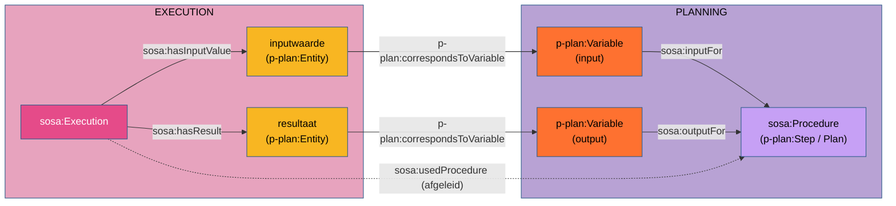

# Bespreking van de uitlijning P-PLAN – SOSA (`pplan-sosa.ttl`)

`pplan-sosa.ttl` is een projectmodule van OSLOthema-SSNSOSA-VL. Ze legt de brug tussen
[P-PLAN](http://purl.org/net/p-plan#) (plannen, stappen en variabelen) en SSN/SOSA 2023
(procedures, inputs, outputs en uitvoeringen), bovenop de W3C-module `sosa-prov`
(`org/w3/www/ns/sosa/alignments/sosa-prov.ttl`). Ze staat in het register van gekende
uitlijningen van de kit (`oslo-ld-kit/registers/alignments.ttl`) onder het ontologie-IRI
`https://github.com/Informatievlaanderen/OSLOthema-SSNSOSA-VL/blob/main/src/main/resources/ontologies/pplan-sosa.ttl`.

Deze bespreking zet de argumentatie samen die verspreid in het project staat (gids R5, R7, R13,
R16; de besprekingen en README's van `paleo`, `verkeersmetingen` en de EMS-voorbeelden;
`resources/Sosa-mapping-bespreking.md` §4.3) en toetst de property chains aan de drielaagse
voorbeelden. Een Engelse versie staat in [`pplan-sosa-discussion.md`](pplan-sosa-discussion.md).

---

## 1. Wat de module zegt

| # | Axioma | Bron van het argument |
|---|---|---|
| A1 | `p-plan:Plan`, `p-plan:Step`, `p-plan:MultiStep` `rdfs:subClassOf sosa:Procedure` | §2 |
| A2 | `sosa:inputFor ⊒ p-plan:isInputVarOf ∘ p-plan:isStepOfPlan` (chain) | §4 |
| A3 | `sosa:outputFor ⊒ p-plan:isOutputVarOf ∘ p-plan:isStepOfPlan` (chain) | §4 |
| A4 | ~~`sosa:hasInputValue rdfs:subPropertyOf prov:used`~~: sinds 2026-10-21 in `sosa-prov` | §3 |
| A5 | `sosa:usedProcedure ⊒ sosa:hasInputValue ∘ p-plan:correspondsToVariable ∘ sosa:inputFor` | §4 |
| A6 | `sosa:usedProcedure ⊒ p-plan:correspondsToStep ∘ p-plan:isDecomposedAsPlan` | §4 |
| A7 | `sosa:usedProcedure ⊒ sosa:hasResult ∘ p-plan:correspondsToVariable ∘ sosa:outputFor` | §4 |
| A8 | `sosa:usedProcedure ⊒ sosa:hasFeatureOfInterest ∘ p-plan:correspondsToVariable ∘ sosa:inputFor` | §4 |

(`⊒` staat hier voor "wordt afgeleid uit": een `owl:propertyChainAxiom` is altijd een
inclusie: de keten impliceert de property, niet omgekeerd.)

---

## 2. Plannen en stappen zijn procedures (A1)

SOSA 2023 definieert een `sosa:Procedure` als een herbruikbare werkwijze; `sosa-prov` maakt ze een
`prov:Plan`. P-PLAN maakt `p-plan:Plan` een `prov:Plan` en beschrijft een `p-plan:Step` als "the
planned execution activity". Beide zijn dus beschrijvingen van hoe iets uitgevoerd wordt, niet de
uitvoering zelf. A1 maakt die gemeenschappelijke lezing expliciet, waardoor een stap of een plan
rechtstreeks de waarde van `sosa:usedProcedure`, `sosa:implements` en `sosa:hasInput` kan zijn.

P-PLAN maakt een `p-plan:MultiStep` zowel een `p-plan:Step` als een `p-plan:Plan`; dat hij een
`sosa:Procedure` is, volgt dus al langs twee wegen. Het aparte axioma is redundant, maar
onschuldig. Wat het dubbele karakter betekent voor `sosa:usedProcedure`, staat in §4.4.

---

## 3. `sosa:hasInputValue ⊂ prov:used` (A4)

> **Opgenomen in `sosa-prov`.** De W3C-werkgroep heeft dit axioma op 2026-10-21 aanvaard en in de
> uitlijningsmodule `sosa-prov` opgenomen (w3c/sdw-sosa-ssn#556, PR #563), naast
> `sosa:hasResult rdfs:subPropertyOf prov:generated`. Het staat daarom niet meer in
> `pplan-sosa.ttl`; het nummer A4 blijft behouden. Deze sectie bewaart de argumentatie zoals ze in
> het issue voorgelegd werd; §3.1 en §3.2 beschrijven de toestand vóór de opname.

### 3.1 Wat SOSA 2023 zelf zegt

> `sosa:hasInputValue` — "assigns a value to an input defined by the Procedure that is used in an
> Execution". *Note:* "The input value MUST be consistent with a hasInput definition from the
> corresponding Procedure". *Scope note:* "a calibration or conditioning parameter, or the output
> of a previous procedure within an extended processing chain."

SOSA geeft de property geen `rdfs:range` en geen superproperty, enkel
`schema:domainIncludes sosa:Execution` (en de subklassen en collecties). Dat valt op, want de
PROV-uitlijningsmodule van SOSA 2023 (`sosa-prov`, niet-normatief, *Annex* "PROV Alignment
Module") lijnt de verwante properties wel uit:
`sosa:hasResult rdfs:subPropertyOf prov:generated`,
`sosa:isResultOf rdfs:subPropertyOf prov:wasGeneratedBy` en
`sosa:hasFeatureOfInterest rdfs:subPropertyOf prov:used`. De normatieve kern
(`ssn/rdf/ontology/core/sosa-common.ttl` in `w3c/sdw-sosa-ssn`) bevat geen PROV-axioma's.
`org/w3/www/ns/sosa/ssn-sosa_2023.ttl` in dit project is een samengevoegd bestand (SOSA, PROV-O en
de uitlijning); dat de axioma's daar naast de SOSA-definities staan, maakt ze niet normatief.

### 3.2 De consequente tegenhanger van `sosa:hasResult`

SOSA beschrijft input en output telkens als paar, op twee niveaus. PROV-O heeft voor de
uitvoering hetzelfde paar. Eén cel van die tabel is leeg:

| | input | output |
|---|---|---|
| procedure (het type) | `sosa:hasInput` / `sosa:inputFor` | `sosa:hasOutput` / `sosa:outputFor` |
| uitvoering (de waarde) | `sosa:hasInputValue` | `sosa:hasResult` |
| PROV-O (activiteit ↔ entiteit) | `prov:used` | `prov:generated` |
| uitlijning in SOSA 2023 | — (sinds 2026-10-21: `hasInputValue ⊂ prov:used`) | `hasResult ⊂ prov:generated` |

Dat de twee properties op uitvoeringsniveau elkaars spiegelbeeld zijn, zegt SOSA zelf, in bijna
dezelfde woorden:

> `sosa:hasResult` — *note:* "The result value MUST be consistent with the hasOutput definition
> from the corresponding Procedure".
> `sosa:hasInputValue` — *note:* "The input value MUST be consistent with a hasInput definition
> from the corresponding Procedure".

En hetzelfde op procedureniveau: `sosa:hasInput` "will typically describe the type of the inputs",
`sosa:hasOutput` "will typically describe the type of the result". `hasResult` staat tot
`hasOutput` zoals `hasInputValue` tot `hasInput`: de concrete waarde tegenover het type. Wie het
resultaat, de waarde van de output, met `prov:generated` uitlijnt, moet de waarde van de input
consequent met `prov:used` uitlijnen. A4 vult zo enkel de lege cel; het voegt geen nieuwe lezing
toe, het trekt de lezing door die SOSA voor de output al maakte.

Het verschil in kardinaliteit doet daar niets aan af: `sosa:hasResult` is functioneel ("An
Execution has a single result"), `sosa:hasInputValue` niet, omdat een procedure meerdere inputs kan
hebben. `prov:generated` en `prov:used` zijn geen van beide functioneel, dus beide inclusies passen.

**Wat dat oplevert: duidelijkheid over de aard van de inputwaarde.** SOSA zegt dat een inputwaarde
een *waarde* is, maar geeft `sosa:hasInputValue` geen bereik. Formeel kan er dus alles staan, ook
een andere observatie. A4 maakt de inputwaarde, via het bereik van `prov:used`, een `prov:Entity`.
PROV-O verklaart `prov:Entity` disjunct met `prov:Activity` (`owl:disjointWith`), en SOSA maakt
alle uitvoeringen activiteiten: `sosa:Execution`, `sosa:Observation`, `sosa:Actuation`,
`sosa:Sampling` en `sosa:Deployment` zijn `rdfs:subClassOf prov:Activity`. Een inputwaarde is dus
nooit een activiteit of een van haar SOSA-subklassen. Bij het resultaat staat dat via
`hasResult ⊂ prov:generated` al vast; A4 trekt die zekerheid door naar de input. Wat een afgeleide
observatie gebruikt, is het *resultaat* van de bronobservatie, niet de bronobservatie zelf; de band
met die laatste is `sosa:relatedObservation` (R7, R13). Argument 5 in §3.3 laat zien dat die
duidelijkheid ook controleerbaar is.

### 3.3 Verdere argumenten

1. **Een waarde is een entiteit.** De definitie spreekt van een *waarde* die aan een input
   toegekend wordt. In PROV-O is een waarde die door een activiteit gebruikt wordt een
   `prov:Entity`; een `sosa:Execution` is een `prov:Activity` (`sosa-prov`). De relatie tussen
   beide is `prov:used` (domein `prov:Activity`, bereik `prov:Entity`).
2. **Het resultaat van de ene uitvoering is de inputwaarde van de volgende.** De scope note
   noemt "the output of a previous procedure within an extended processing chain". Dezelfde
   resource is dan het object van `hasResult` (en dus van `prov:generated`, een entiteit) en van
   `hasInputValue`. Met A4 is `ex:obs1 prov:generated ex:r1 . ex:obs2 prov:used ex:r1` precies de
   PROV-afleidingsketen, opvraagbaar zonder SOSA-kennis (`prov:wasDerivedFrom` volgt er niet
   automatisch uit).
3. **Analoog aan `sosa:hasFeatureOfInterest`.** SOSA lijnt het studieobject al uit met
   `prov:used`. Een inputparameter is net zo goed iets wat de uitvoering gebruikt; er is geen reden
   om de ene gebruiksrelatie wel en de andere niet uit te lijnen. `hasInputValue` is de
   gebruiksrelatie voor wat de *procedure* als input vraagt, `hasFeatureOfInterest` die voor het
   studieobject.
4. **Samenhang met P-PLAN.** `p-plan:Entity ⊂ prov:Entity` is "the input of the execution of a
   p-plan:Activity. It corresponds to a p-plan:Variable"; P-PLAN verwacht `prov:used` tussen de
   activiteit en die entiteit. `sosa:hasInputValue` is de SOSA-naam voor dezelfde relatie, maar
   preciezer: ze zegt dat het om de waarde voor een `sosa:hasInput` van de procedure gaat (R5).
   De EMS-voorbeelden gebruikten tot 2026-10-01 `prov:used` en zijn toen naar `sosa:hasInputValue`
   omgezet (`DatavoorbeeldStilleggingProductielijn/README.md`, *Bijwerking 2026-10-01*); door A4
   volgt `prov:used` er nog altijd uit, zodat PROV-queries blijven werken.
5. **Fouten worden detecteerbaar.** Zonder A4 is `ex:afgeleid sosa:hasInputValue ex:bronobservatie`
   vrij van tegenspraak. Met A4 wordt de bronobservatie een `prov:Entity`, terwijl ze als
   `sosa:Observation` een `prov:Activity` is: `[DISJOINTNESS]` in `validate_file`, `[MODEL INVALID]`
   in de pipeline (R16, fout 3). Precies die fout zat in `paleo/` (alternatief 1) en in
   `verkeersmetingen/` (dagsom naar de collectie), en is op 2026-10-01 rechtgezet
   (`paleo/README.md`, `verkeersmetingen/bespreking.md` §6). De gids maakt er een regel van:
   `sosa:hasInputValue` naar de *resultaten*, `sosa:relatedObservation` naar de *observaties*
   (R7, R13).
6. **Gevolg voor het resultaat.** Omdat een inputwaarde een resource moet zijn, kiest een
   voorbeeld met afgeleide observaties voor `sosa:hasResult` met een eigen resultaat
   (`qudt:QuantityValue`), niet voor `sosa:hasSimpleResult`: een literal kan geen inputwaarde zijn
   (`verkeersmetingen/bespreking.md` §6, R3).

### 3.4 Status

A4 was een axioma over twee kernvocabularia (SOSA en PROV-O) dat geen van beide publiceerde. Dat is
wat R17 (criterium 5) bij een *kandidaat*-vocabularium afkeurt; hier gebeurde het bewust, in een
projectmodule die als uitlijning geregistreerd is, en het voegde enkel de inclusie toe die het
schema van §3.2 vervolledigt. Het werd voorgesteld voor `sosa-prov` (w3c/sdw-sosa-ssn#556, met
§3.2 als kern); omdat die module niet-normatief is, viel het buiten de stop op normatieve
wijzigingen die de werkgroep begin 2025 afsprak (w3c/sdw-sosa-ssn#283). De werkgroep aanvaardde
het en voegde het op 2026-10-21 toe aan `sosa-prov` en aan het hoofdstuk *PROV Alignment* van de
specificatie (PR #563). De kopie in `org/w3/www/ns/sosa/alignments/sosa-prov.ttl` is bijgewerkt
tot die versie, en het axioma is uit `pplan-sosa.ttl` verwijderd: het is nu een uitlijning van
SOSA zelf, geen projectkeuze meer.

---

## 4. Property chains naar `sosa:usedProcedure` (A2, A3, A5–A8)

### 4.1 `p-plan:correspondsToVariable` sluit het vierkant

SOSA beschrijft inputs op twee niveaus, zonder ze met elkaar te verbinden:

- procedureniveau: `sosa:hasInput` / `sosa:inputFor` (procedure ↔ input);
- uitvoeringsniveau: `sosa:hasInputValue` (uitvoering → waarde).

Dat de waarde bij een bepaalde input hoort, staat in SOSA enkel in proza ("MUST be consistent with
a hasInput definition"). Hetzelfde geldt voor `sosa:hasResult` en `sosa:hasOutput`. P-PLAN levert
de ontbrekende zijde: `p-plan:correspondsToVariable` (functioneel, `p-plan:Entity → p-plan:Variable`)
bindt de concrete entiteit aan de variabele die ze in het plan voorstelt.



Met die zijde wordt de vereiste uit de skos:note formeel: wie de keten
`hasInputValue ∘ correspondsToVariable ∘ inputFor` volgt, komt bij de procedure waarvoor de waarde
een input is. A5 en A7 maken daaruit `sosa:usedProcedure`. `correspondsToVariable` is zo de enige
property die twee SOSA-properties van verschillende niveaus (`sosa:hasInputValue` of
`sosa:hasResult` op de uitvoering, `sosa:inputFor` of `sosa:outputFor` op de variabele) aan elkaar
koppelt; zonder die link blijven de plan- en de uitvoeringslaag twee losse grafen.

De types sluiten aan: het domein van `correspondsToVariable` is `p-plan:Entity ⊂ prov:Entity`, en
het bereik van `prov:used` en `prov:generated` (beide via `sosa-prov`) is `prov:Entity`. De
inputwaarde krijgt dus langs twee wegen hetzelfde type, nooit een tegenstrijdig. Evenzo is het
domein van `p-plan:correspondsToStep` `p-plan:Activity ⊂ prov:Activity`, net als
`sosa:Execution`.

A8 doet hetzelfde voor een studieobject dat een inputvariabele van het plan invult (in
`Nigella-Lawson-Brownies/` zijn de ingrediënten zowel feature of interest als input), A6 voor een
uitvoering die bij een stap hoort die als subplan uitgewerkt is (`p-plan:MultiStep`).

### 4.2 Toetsing op de voorbeelden

De ketens zijn met SPARQL-padexpressies nagerekend op de drielaagse voorbeelden (2026-10-14,
query in de bijlage). `inputFor`/`outputFor` tellen daarbij zowel als ze gegeven zijn als via A2/A3.

| Voorbeeld | Gegeven `usedProcedure` | A6 (stap) | A5/A7/A8 (variabelen) |
|---|---|---|---|
| EMS `Isolatieadvies_herzien` | `plan:warmteverlies-classificatie` | idem | idem (overeenstemming) |
| EMS `StilleggingProductielijn_herzien`, actuatie | `plan:beslis_stillegging` | idem | `plan:productielijn_aansturing` |
| EMS `PreHeatingHvac_herzien` | de stap (`step:voorspel_tijdstip`, …) | — | `plan:hvac_preheating` |
| `elektrisch-raam`, `temperatuur-raam` | de stap (`step:temp-meting`, …) | — | `plan:raambesturing` |
| `PGD_geschiktheidskaart` | de stap (`step:score-helling`, …) | — | `plan:pgd-binnen-vlaanderen` **en** `plan:pgd-polders` |
| `Nigella-Lawson-Brownies` | het subplan (`plan:baking`, …) | idem | het subplan **en** `plan:nigella-brownies` |

A6 levert telkens de gegeven procedure op. De variabelenketens geven in de meeste voorbeelden een
andere, ruimere procedure: het plan *waarin* de stap staat, niet de stap zelf.

### 4.3 Waarom de variabelenketens het omvattende plan afleiden

A2 definieert `sosa:inputFor` als `isInputVarOf ∘ isStepOfPlan`: een inputvariabele van een stap
is input voor het *plan* dat die stap bevat. Er is geen axioma dat de variabele ook input voor de
*stap* maakt, hoewel een stap volgens A1 zelf een `sosa:Procedure` is. A5 en A7 erven die
verschuiving. Het commentaar bij A8 noemt het al ("may infer a parent plan rather than the most
specific procedure"), maar het geldt evengoed voor A5 en A7. Wanneer een stap in meer dan één plan
staat (PGD: binnen Vlaanderen en polders), levert de keten meerdere procedures op.

Dat is geen fout in de zin van een inconsistentie: SOSA verbiedt meerdere waarden voor
`usedProcedure` niet, en een uitvoering van een stap is in ruime zin ook een uitvoering volgens
het plan. Maar het is niet wat de voorbeelden bedoelen (§4.4), en het botst met profielen die
`usedProcedure` beperken (zie §5).

### 4.4 Welke procedure: de stap of het definitieplan?

Een `p-plan:MultiStep` is volgens P-PLAN zowel een `p-plan:Step` als een `p-plan:Plan`: "the
representation of a plan that appears as a step of another plan". Geen voorbeeld typeert een stap
expliciet zo, maar het domein van `p-plan:isDecomposedAsPlan` is `p-plan:MultiStep`: elke stap met
`isDecomposedAsPlan` is afgeleid een MultiStep, en dus ook een plan. Dat geldt voor de stappen in
`StilleggingProductielijn`, `Isolatieadvies` en `Nigella`. Bij zo'n stap zijn er twee plannen voor
hetzelfde werk:

| Resource (voorbeeld `StilleggingProductielijn`) | Wat het is | Rol in P-PLAN |
|---|---|---|
| `step:beslis_stillegging` | MultiStep (stap én plan) | het *voorkomen* van de beslissing binnen `plan:productielijn_aansturing` |
| `plan:beslis_stillegging` | Plan | de *definitie* ervan: "the Plan holding the definition of that step" |

De vraag is dus niet "stap of plan", maar "voorkomen of herbruikbare definitie". SOSA 2023
definieert een procedure als een herbruikbare werkwijze. Het voorkomen hoort bij één omvattend
plan; de definitie is wat herbruikbaar is. Daaruit volgt één regel voor `sosa:usedProcedure`:

- **een gewone stap** (zonder decompositie): de stap zelf;
- **een MultiStep**: het plan waarin hij ontleed wordt (`isDecomposedAsPlan`), wat A6 afleidt.

De voorbeelden volgen die regel al: `PreHeatingHvac`, `elektrisch-raam`, `temperatuur-raam` en
`PGD` hebben gewone stappen en geven de stap; `StilleggingProductielijn`, `Isolatieadvies` en
`Nigella` hebben MultiSteps en geven het definitieplan. Wat in §4.2 een verschil tussen de
voorbeelden leek, is één regel toegepast op twee soorten stappen.

Om de variabelenketens (A5, A7) met die regel te laten samenvallen, ter beslissing:

```turtle
# gewone stap: een inputvariabele van een stap is input voor die stap (Step ⊂ Procedure, A1)
p-plan:isInputVarOf  rdfs:subPropertyOf sosa:inputFor .
p-plan:isOutputVarOf rdfs:subPropertyOf sosa:outputFor .

# MultiStep: een inputvariabele van de MultiStep is input voor zijn definitieplan
sosa:inputFor  owl:propertyChainAxiom ( p-plan:isInputVarOf  p-plan:isDecomposedAsPlan ) .
sosa:outputFor owl:propertyChainAxiom ( p-plan:isOutputVarOf p-plan:isDecomposedAsPlan ) .
```

Bij een gewone stap leiden A5 en A7 dan de stap af, bij een MultiStep (ook) het definitieplan,
zoals A6. Twee dingen blijven:

1. **Bij een MultiStep komt ook het voorkomen mee.** Een MultiStep is een stap, dus de subproperty
   maakt de variabele ook input voor het voorkomen. OWL kan "alleen voor stappen zonder
   decompositie" niet uitdrukken. Het voorkomen is wel een plan en een procedure, dus geen fout
   type; het is een extra, minder specifieke waarde.
2. **Het omvattende plan komt mee via A2/A3.** Of A2/A3 moeten blijven, hangt af van de vraag of
   een plan als geheel de inputs van zijn stappen "heeft". In de EMS-voorbeelden staat `sosa:hasInput`
   op het omvattende plan wel expliciet (`plan:productielijn_aansturing`).

Omdat SHACL enkel de gegeven types ziet (*Validation* in de gids), typeert data een stap met
decompositie best expliciet `p-plan:MultiStep`, zoals ze ook hergebruikte superklassen expliciet
typeert.

<!-- TODO: blijven A2/A3 (input en output van het omvattende plan) staan naast het voorstel van §4.4, of vervallen ze, zodat een plan de inputs van zijn stappen niet automatisch "heeft"? -->

---

## 5. Gevolgen en beperkingen

1. **De ketens worden in dit project niet uitgevoerd.** De Jena-regels
   (`domain-range-subproperty.rules`) kennen domein, bereik, subproperty, subklasse en inverse, geen
   `owl:propertyChainAxiom`; `validate_file` gebruikt dezelfde regels. A4 (nu in `sosa-prov`) werkt dus wel (subproperty:
   `prov:used` wordt afgeleid, de disjunctiecontrole vangt een observatie als inputwaarde), A2, A3 en
   A5–A8 niet. Daarom geven de voorbeelden `sosa:usedProcedure` (en in de EMS-voorbeelden
   `sosa:inputFor`) expliciet. De ketens zijn documentatie van de bedoeling en worden pas actief
   met een OWL 2 RL- of DL-redeneerder.
2. **OWL 2 DL.** Een property met een `owl:propertyChainAxiom` is niet *simple*, en een niet-simple
   property mag niet in een cardinaliteitsrestrictie staan. Dat geldt voor `sosa:usedProcedure` al
   door de keten in `sosa-prov` (`sp:executionAssociation ∘ sp:hadProcedure`); A5–A8 maken het
   concreet: met een redeneerder krijgt een observatie die een stap van twee plannen uitvoert, twee
   procedures. `waterkwaliteit.ttl` zette `owl:maxCardinality 1` op `sosa:usedProcedure` (voor
   `wk:WaterkwaliteitObservatie` en `wk:Staalname`); die restricties zijn op 2026-10-14 verwijderd
   (`waterkwaliteit/beslisdocument.md` A10). Een profiel dat één procedure wil, doet dat met een
   SHACL-regel op de gegeven data, niet met een OWL-cardinaliteit.
3. **Functionaliteit van `correspondsToVariable`.** Een entiteit stelt één variabele voor. Wordt
   hetzelfde resultaat in twee stappen onder verschillende variabelen gebruikt, dan moet het om twee
   entiteiten gaan (of om één variabele die input is voor beide stappen). Dat is een P-PLAN-keuze,
   geen gevolg van deze module.
4. **Commentaren bij de ketens.** `sosa:usedProcedure` draagt vier `rdfs:comment`'s naast vier
   ketens; in RDF hangen ze aan de property, niet aan de keten waar ze in het bestand naast staan.
   Wie de koppeling wil bewaren, annoteert de ketens met `owl:Axiom`
   (`owl:annotatedSource`/`annotatedProperty`/`annotatedTarget`) of voegt de commentaren samen.
5. **`sosa:inputFor` en `sosa:outputFor` opnieuw getypeerd.** `rdf:type owl:ObjectProperty` herhaalt
   wat SOSA al zegt; onschuldig.

---

## 6. Samenvatting

- **A4 (`hasInputValue ⊂ prov:used`)** is de consequente tegenhanger van
  `hasResult ⊂ prov:generated`, dat `sosa-prov` vastlegt: SOSA beschrijft beide als de waarde
  bij een `hasInput` respectievelijk `hasOutput` van de procedure, en A4 vult de enige lege cel in
  het schema input/output × procedure/uitvoering/PROV. Zo is een inputwaarde altijd een
  `prov:Entity`, en dus nooit een `prov:Activity` of een van haar SOSA-subklassen (observatie,
  actuatie, bemonstering, deployment). Het volgt ook uit de SOSA-definitie (een
  *waarde*), uit de analogie met `hasFeatureOfInterest ⊂ prov:used` en uit P-PLAN. Het is het axioma dat in de praktijk werkt: het maakt de fout "observatie als
  inputwaarde" zichtbaar (R7, R13, R16). Sinds 2026-10-21 opgenomen in `sosa-prov` (w3c/sdw-sosa-ssn#556).
- **`p-plan:correspondsToVariable`** verbindt het uitvoeringsniveau (`hasInputValue`, `hasResult`,
  `hasFeatureOfInterest`) met het procedureniveau (`inputFor`, `outputFor`) en maakt van SOSA's
  proza-eis ("consistent with a hasInput definition") een opvraagbare en afleidbare relatie.
- **De ketens naar `usedProcedure`** zijn juist van opzet, maar leiden via A2/A3 het omvattende plan
  af in plaats van de uitgevoerde procedure. De regel die de voorbeelden al volgen: bij een gewone
  stap is `usedProcedure` de stap, bij een `p-plan:MultiStep` (stap én plan) het definitieplan
  (`isDecomposedAsPlan`, A6). Voorstel (§4.4): `isInputVarOf ⊑ inputFor` en
  `isOutputVarOf ⊑ outputFor` voor gewone stappen, en ketens over `isDecomposedAsPlan` voor
  MultiSteps.

---

## Bijlage: query voor de toetsing

```sparql
PREFIX sosa:   <http://www.w3.org/ns/sosa/>
PREFIX p-plan: <http://purl.org/net/p-plan#>
SELECT ?exec ?chain ?proc ?asserted WHERE {
  { ?exec p-plan:correspondsToStep/p-plan:isDecomposedAsPlan ?proc . BIND("A6 step" AS ?chain) }
  UNION { ?exec sosa:hasInputValue/p-plan:correspondsToVariable/
               (sosa:inputFor|(p-plan:isInputVarOf/p-plan:isStepOfPlan)) ?proc . BIND("A5 input" AS ?chain) }
  UNION { ?exec sosa:hasResult/p-plan:correspondsToVariable/
               (sosa:outputFor|(p-plan:isOutputVarOf/p-plan:isStepOfPlan)) ?proc . BIND("A7 result" AS ?chain) }
  UNION { ?exec sosa:hasFeatureOfInterest/p-plan:correspondsToVariable/
               (sosa:inputFor|(p-plan:isInputVarOf/p-plan:isStepOfPlan)) ?proc . BIND("A8 foi" AS ?chain) }
  OPTIONAL { ?exec sosa:usedProcedure ?a } BIND(COALESCE(?a, "-") AS ?asserted)
} ORDER BY ?exec ?chain
```

Uitvoeren met `sparql --data <voorbeeld>.ttl --query <query>.rq`.
