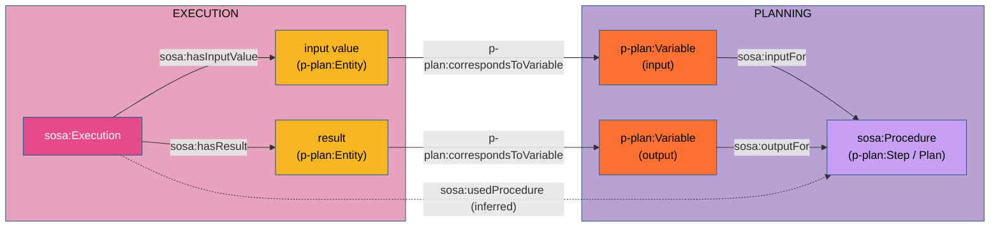

# Discussion of the P-PLAN – SOSA alignment (`pplan-sosa.ttl`)

`pplan-sosa.ttl` is a project module of OSLOthema-SSNSOSA-VL. It bridges
[P-PLAN](http://purl.org/net/p-plan#) (plans, steps and variables) and SSN/SOSA 2023 (procedures,
inputs, outputs and executions), on top of the W3C module `sosa-prov`
(`org/w3/www/ns/sosa/alignments/sosa-prov.ttl`). It is listed in the kit's register of known
alignments (`oslo-ld-kit/registers/alignments.ttl`) under the ontology IRI
`https://github.com/Informatievlaanderen/OSLOthema-SSNSOSA-VL/blob/main/src/main/resources/ontologies/pplan-sosa.ttl`.

This discussion brings together the arguments scattered across the project (guide R5, R7, R13,
R16; the discussions and READMEs of `paleo`, `verkeersmetingen` and the EMS examples;
`resources/Sosa-mapping-bespreking.md` §4.3) and tests the property chains against the
three-layer examples. A Dutch version is in [`pplan-sosa-bespreking.md`](pplan-sosa-bespreking.md).

---

## 1. What the module states

| # | Axiom | Argued in |
|---|---|---|
| A1 | `p-plan:Plan`, `p-plan:Step`, `p-plan:MultiStep` `rdfs:subClassOf sosa:Procedure` | §2 |
| A2 | `sosa:inputFor ⊒ p-plan:isInputVarOf ∘ p-plan:isStepOfPlan` (chain) | §4 |
| A3 | `sosa:outputFor ⊒ p-plan:isOutputVarOf ∘ p-plan:isStepOfPlan` (chain) | §4 |
| A4 | `sosa:hasInputValue rdfs:subPropertyOf prov:used` | §3 |
| A5 | `sosa:usedProcedure ⊒ sosa:hasInputValue ∘ p-plan:correspondsToVariable ∘ sosa:inputFor` | §4 |
| A6 | `sosa:usedProcedure ⊒ p-plan:correspondsToStep ∘ p-plan:isDecomposedAsPlan` | §4 |
| A7 | `sosa:usedProcedure ⊒ sosa:hasResult ∘ p-plan:correspondsToVariable ∘ sosa:outputFor` | §4 |
| A8 | `sosa:usedProcedure ⊒ sosa:hasFeatureOfInterest ∘ p-plan:correspondsToVariable ∘ sosa:inputFor` | §4 |

(`⊒` stands for "is inferred from": an `owl:propertyChainAxiom` is always an inclusion; the chain
implies the property, not the other way round.)

---

## 2. Plans and steps are procedures (A1)

SOSA 2023 defines a `sosa:Procedure` as a reusable workflow; `sosa-prov` makes it a `prov:Plan`.
P-PLAN makes `p-plan:Plan` a `prov:Plan` and describes a `p-plan:Step` as "the planned execution
activity". Both, then, describe how something is carried out, not the execution itself. A1 makes
this shared reading explicit, so that a step or a plan can be the value of `sosa:usedProcedure`,
`sosa:implements` and `sosa:hasInput` directly.

P-PLAN makes a `p-plan:MultiStep` both a `p-plan:Step` and a `p-plan:Plan`, so its being a
`sosa:Procedure` already follows by two routes. The separate axiom is redundant but harmless. What
this double nature means for `sosa:usedProcedure` is discussed in §4.4.

---

## 3. `sosa:hasInputValue ⊂ prov:used` (A4)

### 3.1 What SOSA 2023 itself says

> `sosa:hasInputValue` — "assigns a value to an input defined by the Procedure that is used in an
> Execution". *Note:* "The input value MUST be consistent with a hasInput definition from the
> corresponding Procedure". *Scope note:* "a calibration or conditioning parameter, or the output
> of a previous procedure within an extended processing chain."

SOSA gives the property no `rdfs:range` and no superproperty, only
`schema:domainIncludes sosa:Execution` (and its subclasses and collections). That stands out,
because the PROV alignment module of SOSA 2023 (`sosa-prov`, non-normative, "PROV Alignment
Module") does align the related properties:
`sosa:hasResult rdfs:subPropertyOf prov:generated`,
`sosa:isResultOf rdfs:subPropertyOf prov:wasGeneratedBy` and
`sosa:hasFeatureOfInterest rdfs:subPropertyOf prov:used`. The normative core
(`ssn/rdf/ontology/core/sosa-common.ttl` in `w3c/sdw-sosa-ssn`) contains no PROV axioms.
`org/w3/www/ns/sosa/ssn-sosa_2023.ttl` in this project is a merged file (SOSA, PROV-O and the
alignment); that the axioms sit next to the SOSA definitions there does not make them normative.

### 3.2 The consistent counterpart of `sosa:hasResult`

SOSA describes input and output as a pair, at two levels. PROV-O has the same pair for the
execution. One cell of that table is empty:

| | input | output |
|---|---|---|
| procedure (the type) | `sosa:hasInput` / `sosa:inputFor` | `sosa:hasOutput` / `sosa:outputFor` |
| execution (the value) | `sosa:hasInputValue` | `sosa:hasResult` |
| PROV-O (activity ↔ entity) | `prov:used` | `prov:generated` |
| alignment in SOSA 2023 | — (this project: `hasInputValue ⊂ prov:used`) | `hasResult ⊂ prov:generated` |

SOSA itself says, in almost the same words, that the two execution-level properties mirror each
other:

> `sosa:hasResult` — *note:* "The result value MUST be consistent with the hasOutput definition
> from the corresponding Procedure".
> `sosa:hasInputValue` — *note:* "The input value MUST be consistent with a hasInput definition
> from the corresponding Procedure".

The same holds at procedure level: `sosa:hasInput` "will typically describe the type of the
inputs", `sosa:hasOutput` "will typically describe the type of the result". `hasResult` is to
`hasOutput` what `hasInputValue` is to `hasInput`: the concrete value as opposed to the type.
Whoever aligns the result, the value of the output, with `prov:generated` must, to be consistent,
align the value of the input with `prov:used`. A4 thus only fills the empty cell; it adds no new
reading, it extends the reading SOSA already made for the output.

The difference in cardinality does not affect this: `sosa:hasResult` is functional ("An Execution
has a single result"), `sosa:hasInputValue` is not, because a procedure may have several inputs.
Neither `prov:generated` nor `prov:used` is functional, so both inclusions fit.

**What this yields: clarity about the nature of the input value.** SOSA says that an input value
is a *value*, but gives `sosa:hasInputValue` no range. Formally, then, anything may stand there,
including another observation. Through the range of `prov:used`, A4 makes the input value a
`prov:Entity`. PROV-O declares `prov:Entity` disjoint with `prov:Activity` (`owl:disjointWith`),
and SOSA makes every execution an activity: `sosa:Execution`, `sosa:Observation`,
`sosa:Actuation`, `sosa:Sampling` and `sosa:Deployment` are `rdfs:subClassOf prov:Activity`. An
input value is therefore never an activity or one of its SOSA subclasses. For the result, this is
already settled by `hasResult ⊂ prov:generated`; A4 extends that certainty to the input. What a
derived observation uses is the *result* of the source observation, not the source observation
itself; the link to the latter is `sosa:relatedObservation` (R7, R13). Argument 5 in §3.3 shows
that this clarity can also be checked.

### 3.3 Further arguments

1. **A value is an entity.** The definition speaks of a *value* assigned to an input. In PROV-O, a
   value used by an activity is a `prov:Entity`; a `sosa:Execution` is a `prov:Activity`
   (`sosa-prov`). The relation between the two is `prov:used` (domain `prov:Activity`, range
   `prov:Entity`).
2. **The result of one execution is the input value of the next.** The scope note mentions "the
   output of a previous procedure within an extended processing chain". The same resource is then
   the object of `hasResult` (and so of `prov:generated`, an entity) and of `hasInputValue`. With
   A4, `ex:obs1 prov:generated ex:r1 . ex:obs2 prov:used ex:r1` is exactly the PROV derivation
   chain, queryable without any knowledge of SOSA (`prov:wasDerivedFrom` does not follow
   automatically).
3. **Analogous to `sosa:hasFeatureOfInterest`.** SOSA already aligns the feature of interest with
   `prov:used`. An input parameter is just as much something the execution uses; there is no reason
   to align one usage relation and not the other. `hasInputValue` is the usage relation for what
   the *procedure* requires as input, `hasFeatureOfInterest` the one for the object of study.
4. **Coherence with P-PLAN.** `p-plan:Entity ⊂ prov:Entity` is "the input of the execution of a
   p-plan:Activity. It corresponds to a p-plan:Variable"; P-PLAN expects `prov:used` between the
   activity and that entity. `sosa:hasInputValue` is the SOSA name for the same relation, but more
   precise: it says that the entity is the value for a `sosa:hasInput` of the procedure (R5). Until
   2026-10-01 the EMS examples used `prov:used`; they were then converted to `sosa:hasInputValue`
   (`DatavoorbeeldStilleggingProductielijn/README.md`, *Bijwerking 2026-10-01*). Thanks to A4,
   `prov:used` still follows, so PROV queries keep working.
5. **Errors become detectable.** Without A4, `ex:derived sosa:hasInputValue ex:source-observation`
   is free of contradiction. With A4, the source observation becomes a `prov:Entity`, while as a
   `sosa:Observation` it is a `prov:Activity`: `[DISJOINTNESS]` in `validate_file`,
   `[MODEL INVALID]` in the pipeline (R16, mistake 3). That very mistake was present in `paleo/`
   (alternative 1) and in `verkeersmetingen/` (daily total pointing to the collection), and was
   corrected on 2026-10-01 (`paleo/README.md`, `verkeersmetingen/bespreking.md` §6). The guide
   turns it into a rule: `sosa:hasInputValue` to the *results*, `sosa:relatedObservation` to the
   *observations* (R7, R13).
6. **Consequence for the result.** Because an input value must be a resource, an example with
   derived observations uses `sosa:hasResult` with a result of its own (`qudt:QuantityValue`), not
   `sosa:hasSimpleResult`: a literal cannot be an input value (`verkeersmetingen/bespreking.md` §6,
   R3).

### 3.4 Status

A4 is an axiom about two core vocabularies (SOSA and PROV-O) that neither of them publishes. That
is what R17 (criterion 5) rejects in a *candidate* vocabulary; here it is done deliberately, in a
project module registered as an alignment, and it adds only the inclusion that completes the
scheme of §3.2. It ultimately belongs in `sosa-prov`, next to `hasResult ⊂ prov:generated`. As that
module is non-normative, the request falls outside the freeze on normative changes the working
group agreed at the beginning of 2025 (w3c/sdw-sosa-ssn#283).

<!-- TODO: is there already an issue in w3c/sdw-sosa-ssn proposing sosa:hasInputValue rdfs:subPropertyOf prov:used alongside sosa:hasResult rdfs:subPropertyOf prov:generated? If not, file one with §3.2 as its core. -->

---

## 4. Property chains to `sosa:usedProcedure` (A2, A3, A5–A8)

### 4.1 `p-plan:correspondsToVariable` closes the square

SOSA describes inputs at two levels without connecting them:

- procedure level: `sosa:hasInput` / `sosa:inputFor` (procedure ↔ input);
- execution level: `sosa:hasInputValue` (execution → value).

That the value belongs to a particular input is stated in SOSA only in prose ("MUST be consistent
with a hasInput definition"). The same holds for `sosa:hasResult` and `sosa:hasOutput`. P-PLAN
supplies the missing side: `p-plan:correspondsToVariable` (functional,
`p-plan:Entity → p-plan:Variable`) binds the concrete entity to the variable it represents in the
plan.



With that side in place, the requirement in the skos:note becomes formal: following the chain
`hasInputValue ∘ correspondsToVariable ∘ inputFor` leads to the procedure for which the value is an
input. A5 and A7 turn this into `sosa:usedProcedure`. `correspondsToVariable` is thus the only
property that links two SOSA properties at different levels (`sosa:hasInputValue` or
`sosa:hasResult` on the execution, `sosa:inputFor` or `sosa:outputFor` on the variable); without
that link the planning and execution layers remain two disconnected graphs.

The types fit together: the domain of `correspondsToVariable` is `p-plan:Entity ⊂ prov:Entity`,
and the range of `prov:used` (A4) and `prov:generated` (`sosa-prov`) is `prov:Entity`. The input
value therefore receives the same type by two routes, never a conflicting one. Likewise, the domain
of `p-plan:correspondsToStep` is `p-plan:Activity ⊂ prov:Activity`, as is `sosa:Execution`.

A8 does the same for a feature of interest that fills an input variable of the plan (in
`Nigella-Lawson-Brownies/` the ingredients are both feature of interest and input), A6 for an
execution belonging to a step that is worked out as a sub-plan (`p-plan:MultiStep`).

### 4.2 Testing against the examples

The chains were recomputed with SPARQL property paths on the three-layer examples (2026-10-14,
query in the appendix). `inputFor`/`outputFor` count both when asserted and when obtained via A2/A3.

| Example | Asserted `usedProcedure` | A6 (step) | A5/A7/A8 (variables) |
|---|---|---|---|
| EMS `Isolatieadvies_herzien` | `plan:warmteverlies-classificatie` | same | same (agreement) |
| EMS `StilleggingProductielijn_herzien`, actuation | `plan:beslis_stillegging` | same | `plan:productielijn_aansturing` |
| EMS `PreHeatingHvac_herzien` | the step (`step:voorspel_tijdstip`, …) | — | `plan:hvac_preheating` |
| `elektrisch-raam`, `temperatuur-raam` | the step (`step:temp-meting`, …) | — | `plan:raambesturing` |
| `PGD_geschiktheidskaart` | the step (`step:score-helling`, …) | — | `plan:pgd-binnen-vlaanderen` **and** `plan:pgd-polders` |
| `Nigella-Lawson-Brownies` | the sub-plan (`plan:baking`, …) | same | the sub-plan **and** `plan:nigella-brownies` |

A6 yields the asserted procedure every time. In most examples the variable chains yield a
different, broader procedure: the plan *containing* the step, not the step itself.

### 4.3 Why the variable chains infer the enclosing plan

A2 defines `sosa:inputFor` as `isInputVarOf ∘ isStepOfPlan`: an input variable of a step is an
input for the *plan* that contains the step. No axiom makes the variable an input for the *step*
as well, although by A1 a step is itself a `sosa:Procedure`. A5 and A7 inherit this shift. The
comment on A8 already mentions it ("may infer a parent plan rather than the most specific
procedure"), but it applies equally to A5 and A7. When a step belongs to more than one plan (PGD:
inland Flanders and polders), the chain yields several procedures.

This is not an error in the sense of an inconsistency: SOSA does not forbid several values of
`usedProcedure`, and an execution of a step is, broadly speaking, also an execution according to
the plan. But it is not what the examples intend (§4.4), and it clashes with profiles that restrict
`usedProcedure` (see §5).

### 4.4 Which procedure: the step or the definition plan?

According to P-PLAN, a `p-plan:MultiStep` is both a `p-plan:Step` and a `p-plan:Plan`: "the
representation of a plan that appears as a step of another plan". No example types a step that
way explicitly, but the domain of `p-plan:isDecomposedAsPlan` is `p-plan:MultiStep`: every step with
`isDecomposedAsPlan` is inferred to be a MultiStep, and therefore also a plan. That holds for the
steps in `StilleggingProductielijn`, `Isolatieadvies` and `Nigella`. For such a step there are two
plans for the same work:

| Resource (example `StilleggingProductielijn`) | What it is | Role in P-PLAN |
|---|---|---|
| `step:beslis_stillegging` | MultiStep (step and plan) | the *occurrence* of the decision within `plan:productielijn_aansturing` |
| `plan:beslis_stillegging` | Plan | its *definition*: "the Plan holding the definition of that step" |

The question is therefore not "step or plan" but "occurrence or reusable definition". SOSA 2023
defines a procedure as a reusable workflow. The occurrence belongs to one enclosing plan; the
definition is what can be reused. This gives one rule for `sosa:usedProcedure`:

- **a plain step** (no decomposition): the step itself;
- **a MultiStep**: the plan it is decomposed into (`isDecomposedAsPlan`), which A6 infers.

The examples already follow this rule: `PreHeatingHvac`, `elektrisch-raam`, `temperatuur-raam` and
`PGD` have plain steps and give the step; `StilleggingProductielijn`, `Isolatieadvies` and `Nigella`
have MultiSteps and give the definition plan. What looked like a difference between the examples in
§4.2 is one rule applied to two kinds of step.

To make the variable chains (A5, A7) coincide with that rule, for decision:

```turtle
# plain step: an input variable of a step is an input for that step (Step ⊂ Procedure, A1)
p-plan:isInputVarOf  rdfs:subPropertyOf sosa:inputFor .
p-plan:isOutputVarOf rdfs:subPropertyOf sosa:outputFor .

# MultiStep: an input variable of the MultiStep is an input for its definition plan
sosa:inputFor  owl:propertyChainAxiom ( p-plan:isInputVarOf  p-plan:isDecomposedAsPlan ) .
sosa:outputFor owl:propertyChainAxiom ( p-plan:isOutputVarOf p-plan:isDecomposedAsPlan ) .
```

For a plain step, A5 and A7 then infer the step; for a MultiStep they (also) infer the definition
plan, as A6 does. Two things remain:

1. **For a MultiStep, the occurrence comes along.** A MultiStep is a step, so the subproperty also
   makes the variable an input for the occurrence. OWL cannot express "only for steps without
   decomposition". The occurrence is a plan and a procedure, so the type is not wrong; it is an
   additional, less specific value.
2. **The enclosing plan comes along via A2/A3.** Whether A2/A3 should stay depends on whether a
   plan as a whole "has" the inputs of its steps. In the EMS examples, `sosa:hasInput` is asserted
   explicitly on the enclosing plan (`plan:productielijn_aansturing`).

Because SHACL sees only the asserted types (*Validation* in the guide), data should type a step
with a decomposition explicitly as `p-plan:MultiStep`, just as it types reused superclasses
explicitly.

<!-- TODO: do A2/A3 (input and output of the enclosing plan) stay alongside the proposal of §4.4, or are they dropped, so that a plan does not automatically "have" the inputs of its steps? -->

---

## 5. Consequences and limitations

1. **The chains are not executed in this project.** The Jena rules
   (`domain-range-subproperty.rules`) cover domain, range, subproperty, subclass and inverse, not
   `owl:propertyChainAxiom`; `validate_file` uses the same rules. A4 therefore does take effect
   (subproperty: `prov:used` is inferred, and the disjointness check catches an observation used as
   an input value), but A2, A3 and A5–A8 do not. That is why the examples assert
   `sosa:usedProcedure` (and, in the EMS examples, `sosa:inputFor`) explicitly. The chains document
   the intent and only take effect with an OWL 2 RL or DL reasoner.
2. **OWL 2 DL.** A property with an `owl:propertyChainAxiom` is not *simple*, and a non-simple
   property may not appear in a cardinality restriction. This already holds for
   `sosa:usedProcedure` because of the chain in `sosa-prov`
   (`sp:executionAssociation ∘ sp:hadProcedure`); A5–A8 make it concrete: with a reasoner, an
   observation executing a step of two plans gets two procedures. `waterkwaliteit.ttl` put
   `owl:maxCardinality 1` on `sosa:usedProcedure` (for `wk:WaterkwaliteitObservatie` and
   `wk:Staalname`); those restrictions were removed on 2026-10-14
   (`waterkwaliteit/beslisdocument.md` A10). A profile that wants a single procedure expresses
   that as a SHACL rule on the asserted data, not as an OWL cardinality.
3. **Functionality of `correspondsToVariable`.** An entity represents one variable. If the same
   result is used in two steps under different variables, these must be two entities (or one
   variable that is an input for both steps). That is a P-PLAN choice, not a consequence of this
   module.
4. **Comments on the chains.** `sosa:usedProcedure` carries four `rdfs:comment`s alongside four
   chains; in RDF they attach to the property, not to the chain they sit next to in the file. To
   keep the link, annotate the chains with `owl:Axiom`
   (`owl:annotatedSource`/`annotatedProperty`/`annotatedTarget`) or merge the comments.
5. **`sosa:inputFor` and `sosa:outputFor` typed again.** `rdf:type owl:ObjectProperty` repeats what
   SOSA already states; harmless.

---

## 6. Summary

- **A4 (`hasInputValue ⊂ prov:used`)** is the consistent counterpart of
  `hasResult ⊂ prov:generated`, which `sosa-prov` states: SOSA describes both as the value for
  a `hasInput` or `hasOutput` of the procedure, and A4 fills the only empty cell in the scheme
  input/output × procedure/execution/PROV. An input value is thus always a `prov:Entity`, and so
  never a `prov:Activity` or one of its SOSA subclasses (observation, actuation, sampling,
  deployment). It also follows from the SOSA definition (a *value*),
  from the analogy with `hasFeatureOfInterest ⊂ prov:used` and from P-PLAN. It is the axiom that works in practice: it exposes the mistake "observation as
  input value" (R7, R13, R16). A candidate to propose for `sosa-prov`.
- **`p-plan:correspondsToVariable`** connects the execution level (`hasInputValue`, `hasResult`,
  `hasFeatureOfInterest`) with the procedure level (`inputFor`, `outputFor`) and turns SOSA's prose
  requirement ("consistent with a hasInput definition") into a relation that can be queried and
  inferred.
- **The chains to `usedProcedure`** are sound in design, but via A2/A3 they infer the enclosing plan
  instead of the procedure actually executed. The rule the examples already follow: for a plain
  step, `usedProcedure` is the step; for a `p-plan:MultiStep` (step and plan), the definition plan
  (`isDecomposedAsPlan`, A6). Proposal (§4.4): `isInputVarOf ⊑ inputFor` and
  `isOutputVarOf ⊑ outputFor` for plain steps, and chains over `isDecomposedAsPlan` for
  MultiSteps.

---

## Appendix: query used for the test

```sparql
PREFIX sosa:   <http://www.w3.org/ns/sosa/>
PREFIX p-plan: <http://purl.org/net/p-plan#>
SELECT ?exec ?chain ?proc ?asserted WHERE {
  { ?exec p-plan:correspondsToStep/p-plan:isDecomposedAsPlan ?proc . BIND("A6 step" AS ?chain) }
  UNION { ?exec sosa:hasInputValue/p-plan:correspondsToVariable/
               (sosa:inputFor|(p-plan:isInputVarOf/p-plan:isStepOfPlan)) ?proc . BIND("A5 input" AS ?chain) }
  UNION { ?exec sosa:hasResult/p-plan:correspondsToVariable/
               (sosa:outputFor|(p-plan:isOutputVarOf/p-plan:isStepOfPlan)) ?proc . BIND("A7 result" AS ?chain) }
  UNION { ?exec sosa:hasFeatureOfInterest/p-plan:correspondsToVariable/
               (sosa:inputFor|(p-plan:isInputVarOf/p-plan:isStepOfPlan)) ?proc . BIND("A8 foi" AS ?chain) }
  OPTIONAL { ?exec sosa:usedProcedure ?a } BIND(COALESCE(?a, "-") AS ?asserted)
} ORDER BY ?exec ?chain
```

Run with `sparql --data <example>.ttl --query <query>.rq`.
